# Manual Técnico — Proyecto Conectividad XXI: Integración de Operadores Nacionales

**Universidad de San Carlos de Guatemala (USAC)**  
**Facultad de Ingeniería — Escuela de Ciencias y Sistemas**  
**Curso:** Redes de Computadoras 2 (Segundo Semestre 2026)  
**Estudiante:** Bryan Alejandro Anona Paredes  
**Carné:** `202307272`  
**Dominio Institucional:** `www.proyecto2_202307272.com`  
**Entregables Principales:** `Proyecto2_202307272.pkt` | `Wireshark/captura_wireshark_202307272.pcapng` | `Manual_Tecnico_202307272.pdf` | `Proyecto2_Presentacion_202307272.pdf`

---

## 1. Resumen Ejecutivo y Parámetros Personalizados del Carné

El **Proyecto Conectividad XXI** resuelve el desafío de integrar la infraestructura nacional de tres proveedores de servicios de Internet (ISP) independientes —**ISP 1: FibraNet GT**, **ISP 2: AndinaCom** e **ISP 3: MoonLink**— mediante un anillo de fibra óptica monomodo (`1000BASE-LX/LH`) que ejecuta **eBGP** entre Sistemas Autónomos distintos (`AS 65001`, `AS 65002` y `AS 65003`), con Router IDs asignados `10.1.0.1`, `10.2.0.1` y `10.3.0.1`.

Cada operador mantiene una topología física y lógica especializada que responde a requerimientos arquitectónicos estrictos:
1. **ISP 1 (FibraNet GT):** Topología en **Árbol Jerárquico**, enrutamiento interior con **OSPF Área 0 (Proceso 10)**, doble agregación de enlaces **EtherChannel L3 (LACP 802.3ad)** en interfaces troncales, y alojamiento del servidor central corporativo de **DNS y Portal Web HTTP/HTTPS** (`192.168.72.38`).
2. **ISP 2 (AndinaCom):** Topología **Jerárquica de 4 Capas** (Borde, Núcleo Interior, Distribución y Acceso), enrutamiento interior con **OSPF Área 0 (Proceso 20)**, redundancia de primer salto con **HSRP (Grupos 21 y 22)** con prioridades activas, preemption y tracking de interfaces, switches de acceso segregados en **VLAN 21 (Ventas)** y **VLAN 22 (Facturación)**, y alojamiento del servidor centralizado de **DHCP** (`192.168.72.66`) con 7 pools nacionales.
3. **ISP 3: MoonLink:** Topología **Hub-and-Spoke Radial**, enrutamiento interior con **EIGRP (AS 30)** con métrica compuesta optimizada, enlaces redundantes con **EtherChannel L3 (LACP)**, y cobertura inalámbrica para hosts móviles (**Laptops y Smartphone**) mediante Punto de Acceso Linksys WRT300N configurado en modo puente con autenticación **WPA2-Personal (AES)** y SSID `MOONLINK_202307272`.

La seguridad y privacidad corporativa se garantiza mediante **Listas de Control de Acceso (ACLs) Extendidas** aplicadas en la interfaz de entrada (`in`) del gateway de primer salto de cada departamento, asegurando filtrado perimetral temprano, aislamiento unidireccional para el Centro de Operaciones de Seguridad (SOC), y bloqueo total bidireccional entre áreas financieras y de atención al público.

### 1.1 Parámetros de Red Derivados del Carné `202307272`

De acuerdo con la Sección 3.2 del enunciado oficial del proyecto, los bloques de direccionamiento IPv4 y parámetros de configuración se derivan directamente de los dígitos del carné **`202307272`**:

| Elemento de Red | Regla del Enunciado | Dígito(s) (`202307272`) | Red Base Asignada / Parámetro | Protocolo / Rol Principal |
| :--- | :--- | :---: | :---: | :--- |
| **Interconexión Core BGP y `/30`** | `XX` = últimos 2 dígitos del carné | `72` | **`192.168.72.0/16`** | Enlaces punto a punto `/30` Core BGP, OSPF, EIGRP y Servidores |
| **ISP 1: FibraNet GT** | `X` = último dígito del carné | `2` | **`172.16.12.0/24`** | Topología en Árbol \| OSPF Área 0 (PID 10) \| BGP `AS 65001` (RID `10.1.0.1`) |
| **ISP 2: AndinaCom** | `X` = último dígito del carné | `2` | **`172.16.22.0/24`** | Topología Jerárquica \| OSPF Área 0 (PID 20) \| BGP `AS 65002` (RID `10.2.0.1`) \| HSRP |
| **ISP 3: MoonLink** | `X` = primer dígito del carné | `2` | **`172.16.32.0/24`** | Topología Hub-and-Spoke \| EIGRP `AS 30` \| BGP `AS 65003` (RID `10.3.0.1`) \| WiFi |
| **Dominio Web / DNS** | `www.proyecto2_CARNET.com` | `202307272` | **`www.proyecto2_202307272.com`** | Resuelve a `192.168.72.38` (`SRV-DNS-WEB` en ISP 1) |
| **SSID y Clave WiFi (ISP 3)** | `MOONLINK_CARNET` | `202307272` | **`MOONLINK_202307272`** | WPA2-PSK (AES) \| Cobertura para Laptops y Smartphones |
| **Servidor DHCP Central** | En ISP 2 (AndinaCom) | `72` | **`192.168.72.66`** | 7 Pools (`POOL_ADM`, `POOL_ATC`, `POOL_VEN`, `POOL_FAC`, `POOL_SOP`, `POOL_SEG`, `POOL_WIFI`) |

---

## 2. Diagramas de Topología y Diseño Arquitectónico

### 2.1 Entorno Operativo en Cisco Packet Tracer 9.0.1

La siguiente captura de pantalla real del sistema operativo Windows muestra la ventana principal de **Cisco Packet Tracer 9.0.1** con el proyecto `Proyecto2_202307272.pkt` cargado, activo, con todos sus 46 nodos y enlaces en estado convergente (luces verdes de enlace activas) y tráfico cursando en tiempo real:

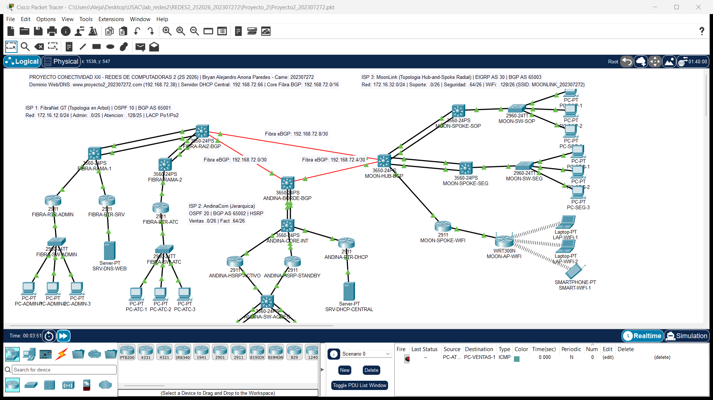

### 2.2 Topología General Integrada (46 Dispositivos)

La siguiente captura corresponde a la exportación directa del espacio de trabajo completo de Packet Tracer, mostrando la distribución espacial única con **ISP 1 (Árbol)** a la izquierda, **ISP 2 (Jerárquica)** en la zona central e inferior, e **ISP 3 (Hub-and-Spoke)** a la derecha, enlazados en el centro por el triángulo de fibra óptica eBGP:

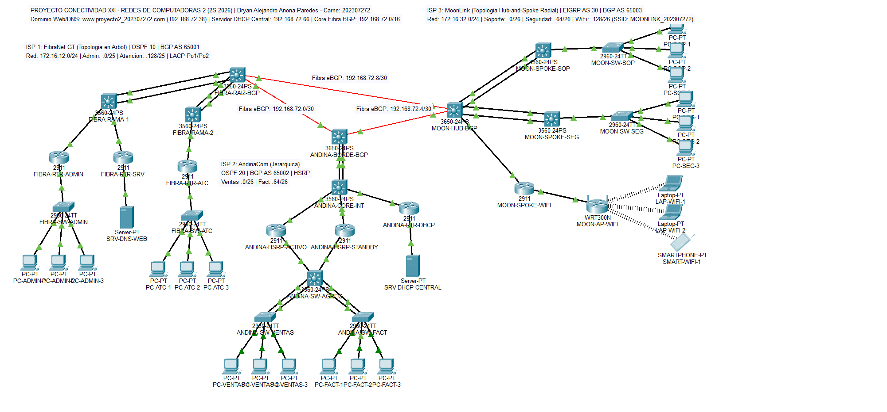

### 2.3 Diagramas Individuales por Operador (ISP)

#### 2.3.1 ISP 1: FibraNet GT — Topología en Árbol Jerárquico
FibraNet GT implementa una estructura en árbol balanceada encabezada por el switch multicapa raíz `FIBRA-RAIZ-BGP`, distribuyendo el tráfico hacia las ramas intermedias `FIBRA-RAMA-1` y `FIBRA-RAMA-2` mediante canales agregados LACP L3 (`Port-channel 1` y `Port-channel 2`). Desde allí se ramifican los routers dedicados de Administración (`FIBRA-RTR-ADMIN`), Atención al Cliente (`FIBRA-RTR-ATC`) y Servidores (`FIBRA-RTR-SRV`), asegurando aislamiento de dominios de colisión y difusión.

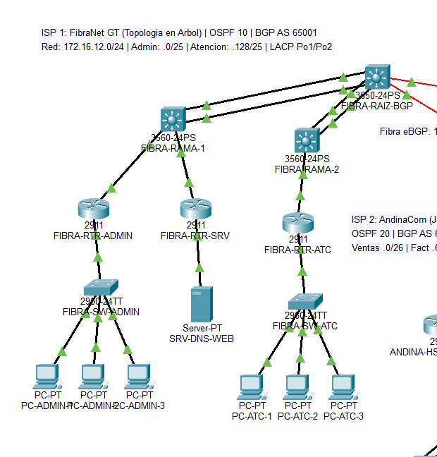

#### 2.3.2 ISP 2: AndinaCom — Topología Jerárquica de 4 Capas con HSRP
AndinaCom está diseñado bajo el modelo de capas de Cisco (Borde BGP `ANDINA-BORDE-BGP`, Núcleo Interior `ANDINA-CORE-INT`, Distribución Redundante `ANDINA-HSRP-ACTIVO` y `ANDINA-HSRP-STANDBY`, y Agregación/Acceso `ANDINA-SW-AGREG`, `ANDINA-SW-VENTAS` y `ANDINA-SW-FACT`). La capa de distribución ejecuta HSRP con prioridades 105 y 100, preemption y tracking de interfaces hacia el core, proveyendo alta disponibilidad para las VLANs 21 (Ventas) y 22 (Facturación), además de conectar el router dedicado `ANDINA-RTR-DHCP` que sirve a toda la red nacional.

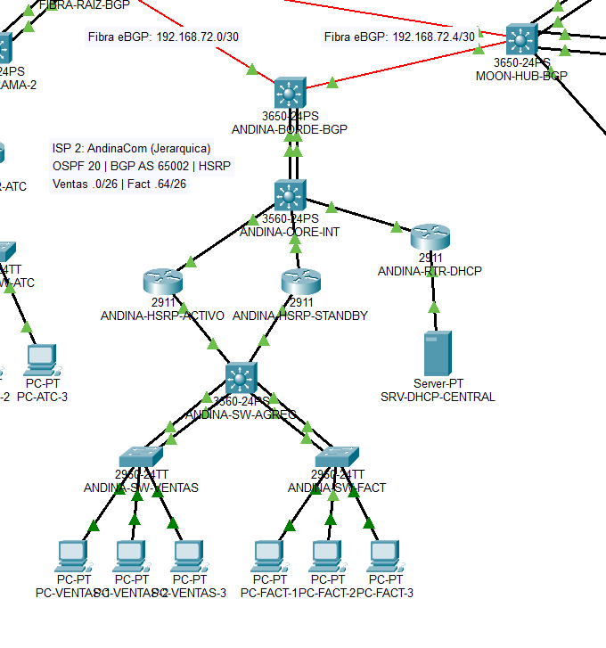

#### 2.3.3 ISP 3: MoonLink — Topología Hub-and-Spoke Radial con Cobertura Inalámbrica
MoonLink adopta una topología de estrella o Hub-and-Spoke estricta con el switch central `MOON-HUB-BGP` actuando como Hub BGP/EIGRP. Los rayos o spokes conectan en forma radial hacia `MOON-SPOKE-SOP` (Soporte Técnico, vía `Port-channel 1` LACP), `MOON-SPOKE-SEG` (Seguridad / SOC, vía `Port-channel 2` LACP) y `MOON-SPOKE-WIFI` (Router 2911 conectado al AP Linksys WRT300N), extendiendo conectividad cableada e inalámbrica con cero bucles de conmutación.

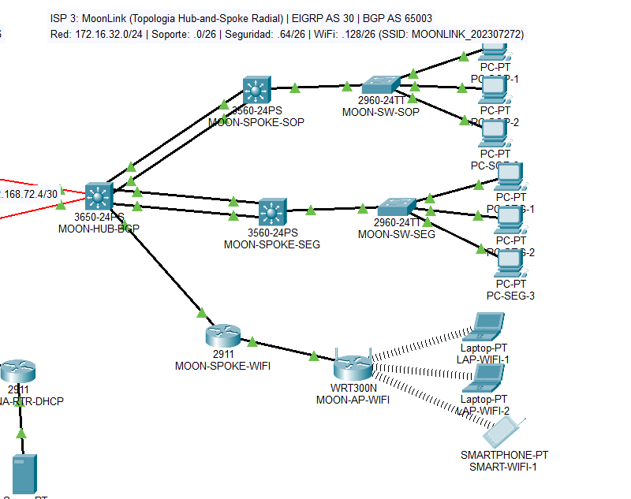

### 2.4 Esquema Lógico de Interconexión Nacional y Distribución de Puertos

```
                                  NÚCLEO NACIONAL DE FIBRA ÓPTICA (eBGP)
                                            (192.168.72.0/16)
               (Gi1/1/2: .9)                                                  (Gi1/1/2: .10)
             [FIBRA-RAIZ-BGP] <============================================> [MOON-HUB-BGP]
             Cisco 3650-24PS                192.168.72.8/30                 Cisco 3650-24PS
             AS 65001 (RID 10.1.0.1)                                         AS 65003 (RID 10.3.0.1)
             OSPF PID 10 Área 0                                             EIGRP AS 30
                    \\ (Gi1/1/1: .1)                           (Gi1/1/1: .6) ////
                     \\                                                     ////
       192.168.72.0/30\\                                                   //// 192.168.72.4/30
                       \\                 (Gi1/1/1: .2)                   ////
                        \\             [ANDINA-BORDE-BGP]                ////
                         \\===>         Cisco 3650-24PS          <======////
                                          AS 65002 (RID 10.2.0.1)
                                          OSPF PID 20 Área 0
                                                  ||
                                                  || Po1 (LACP L3: Gi1/0/1-2)
                                                  || 192.168.72.48/30
                                                  vv
                                          [ANDINA-CORE-INT]
                                           Cisco 3560-24PS
                                           /      |       \
                   192.168.72.52/30       /       |        \ 192.168.72.56/30
                  +----------------------+        |         +----------------------+
                  | (Gi0/1)                       | (Gi0/1: 192.168.72.61)         | (Gi0/1)
                  v                               v                                v
        [ANDINA-HSRP-ACTIVO]              [ANDINA-RTR-DHCP]              [ANDINA-HSRP-STANDBY]
         Cisco 2911                        Cisco 2911                     Cisco 2911
         HSRP Pri 105 (Activo)             (Gi0/0: .65)                   HSRP Pri 100 (Standby)
         Preemption + Tracking                     |                      Preemption
                  \ (Gi0/2 Trunk)                  |                      // (Gi0/2 Trunk)
                   \\                            v                     ////
                    \\                   [SRV-DHCP-CENTRAL]           ////
                     \\                 192.168.72.66 /30            ////
                      +==================> [ANDINA-SW-AGREG] <========+
                                            Cisco 3560-24PS
                                            /             \
                               Po2 (LACP L2)               Po3 (LACP L2)
                                           /                 \
                                          v                   v
                                  [ANDINA-SW-VENTAS]    [ANDINA-SW-FACT]
                                   VLAN 21               VLAN 22
                                   PC-VENTAS-1..3        PC-FACT-1..3
```

---

## 3. Diseño de Direccionamiento IP y Tablas de Subneteo (VLSM / FLSM)

### 3.1 Subneteo de ISP 1: FibraNet GT (`172.16.12.0/24`)

El bloque asignado a ISP 1 es `172.16.12.0/24`. Se requiere cubrir un mínimo de 75 hosts para Administración y 75 hosts para Atención al Cliente, además de los enlaces internos:

| Departamento / Segmento | Hosts Requeridos | Prefijo | Máscara de Subred | Subred Asignada | Rango de Hosts Útiles | Gateway Asignado | Broadcast |
| :--- | :---: | :---: | :--- | :--- | :--- | :--- | :--- |
| **Administración** | &ge; 75 | `/25` | `255.255.255.128` | `172.16.12.0/25` | `172.16.12.1` – `172.16.12.126` | `172.16.12.1` (`FIBRA-RTR-ADMIN` Fa0/0) | `172.16.12.127` |
| **Atención al Cliente** | &ge; 75 | `/25` | `255.255.255.128` | `172.16.12.128/25` | `172.16.12.129` – `172.16.12.254` | `172.16.12.129` (`FIBRA-RTR-ATC` Fa0/0) | `172.16.12.255` |

*Nota:* Los servidores centrales y enlaces de infraestructura de ISP 1 se direccionan sobre el bloque `/16` del carné (`192.168.72.36/30` para `SRV-DNS-WEB`).

### 3.2 Subneteo de ISP 2: AndinaCom (`172.16.22.0/24`)

El bloque asignado a ISP 2 es `172.16.22.0/24`, subdividido con VLSM para cubrir las VLANs departamentales y enlaces de distribución:

| Departamento / Segmento | VLAN | Hosts Requeridos | Prefijo | Máscara de Subred | Subred Asignada | Rango Útil / VIP | Default Gateway (HSRP VIP) | Broadcast |
| :--- | :---: | :---: | :---: | :--- | :--- | :--- | :--- | :--- |
| **Ventas** | 21 | 60 | `/26` | `255.255.255.192` | `172.16.22.0/26` | `172.16.22.1` – `172.16.22.62` | VIP `172.16.22.1` (Activo `.2`, Stby `.3`) | `172.16.22.63` |
| **Facturación** | 22 | 60 | `/26` | `255.255.255.192` | `172.16.22.64/26` | `172.16.22.65` – `172.16.22.126` | VIP `172.16.22.65` (Activo `.66`, Stby `.67`) | `172.16.22.127` |
| **Reserva Crecimiento 1** | — | — | `/26` | `255.255.255.192` | `172.16.22.128/26` | `172.16.22.129` – `172.16.22.190` | Disponible para expansión | `172.16.22.191` |
| **Reserva Crecimiento 2** | — | — | `/26` | `255.255.255.192` | `172.16.22.192/26` | `172.16.22.193` – `172.16.22.254` | Disponible para expansión | `172.16.22.255` |

### 3.3 Subneteo de ISP 3: MoonLink (`172.16.32.0/24`)

El bloque asignado a ISP 3 es `172.16.32.0/24`, dimensionado para los tres segmentos radiales (dos cableados y uno inalámbrico):

| Departamento / Segmento | Tipo Enlace | Hosts Requeridos | Prefijo | Máscara de Subred | Subred Asignada | Rango de Hosts Útiles | Gateway Asignado | Broadcast |
| :--- | :---: | :---: | :---: | :--- | :--- | :--- | :--- | :--- |
| **Soporte Técnico** | Cableado | &ge; 45 | `/26` | `255.255.255.192` | `172.16.32.0/26` | `172.16.32.1` – `172.16.32.62` | `172.16.32.1` (`MOON-SPOKE-SOP` Fa0/0) | `172.16.32.63` |
| **Seguridad (SOC)** | Cableado | &ge; 45 | `/26` | `255.255.255.192` | `172.16.32.64/26` | `172.16.32.65` – `172.16.32.126` | `172.16.32.65` (`MOON-SPOKE-SEG` Fa0/0) | `172.16.32.127` |
| **Soporte WiFi (WLAN)** | Inalámbrico | 60 | `/26` | `255.255.255.192` | `172.16.32.128/26` | `172.16.32.129` – `172.16.32.190` | `172.16.32.129` (`MOON-SPOKE-WIFI` Gi0/1) | `172.16.32.191` |

### 3.4 Subredes `/30` de Interconexión y Servicios (`192.168.72.0/16`)

| Identificador | Subred `/30` | Dispositivo A (Interfaz - IP) | Dispositivo B (Interfaz - IP) | Protocolo / Propósito |
| :--- | :--- | :--- | :--- | :--- |
| **BGP-12** | `192.168.72.0/30` | `FIBRA-RAIZ-BGP` (Gi1/1/1: `.1`) | `ANDINA-BORDE-BGP` (Gi1/1/1: `.2`) | eBGP AS 65001 ↔ AS 65002 |
| **BGP-23** | `192.168.72.4/30` | `ANDINA-BORDE-BGP` (Gi1/1/2: `.5`) | `MOON-HUB-BGP` (Gi1/1/1: `.6`) | eBGP AS 65002 ↔ AS 65003 |
| **BGP-13** | `192.168.72.8/30` | `FIBRA-RAIZ-BGP` (Gi1/1/2: `.9`) | `MOON-HUB-BGP` (Gi1/1/2: `.10`) | eBGP AS 65001 ↔ AS 65003 |
| **ISP1-P1** | `192.168.72.16/30`| `FIBRA-RAIZ-BGP` (Po1: `.17`) | `FIBRA-RAMA-1` (Po1: `.18`) | OSPF PID 10 (EtherChannel LACP L3) |
| **ISP1-P2** | `192.168.72.20/30`| `FIBRA-RAIZ-BGP` (Po2: `.21`) | `FIBRA-RAMA-2` (Po2: `.22`) | OSPF PID 10 (EtherChannel LACP L3) |
| **ISP1-R1** | `192.168.72.24/30`| `FIBRA-RAMA-1` (Gi0/1: `.25`) | `FIBRA-RTR-ADMIN` (Gi0/0: `.26`) | OSPF PID 10 (Acceso Administración) |
| **ISP1-R2** | `192.168.72.28/30`| `FIBRA-RAMA-1` (Gi0/2: `.29`) | `FIBRA-RTR-SRV` (Gi0/0: `.30`) | OSPF PID 10 (Acceso Servidor Web/DNS) |
| **ISP1-R3** | `192.168.72.32/30`| `FIBRA-RAMA-2` (Gi0/1: `.33`) | `FIBRA-RTR-ATC` (Gi0/0: `.34`) | OSPF PID 10 (Acceso Atención Cliente) |
| **SRV-WEB** | `192.168.72.36/30`| `FIBRA-RTR-SRV` (Gi0/1: `.37`) | `SRV-DNS-WEB` (Fa0: `.38`) | Segmento Servidor Central Web/DNS |
| **ISP2-CORE**| `192.168.72.48/30`| `ANDINA-BORDE-BGP` (Po1: `.49`) | `ANDINA-CORE-INT` (Po1: `.50`) | OSPF PID 20 (EtherChannel LACP L3) |
| **ISP2-H1** | `192.168.72.52/30`| `ANDINA-CORE-INT` (Gi0/1: `.53`) | `ANDINA-HSRP-ACTIVO` (Gi0/1: `.54`) | OSPF PID 20 (Enlace Distribución Activo) |
| **ISP2-H2** | `192.168.72.56/30`| `ANDINA-CORE-INT` (Gi0/2: `.57`) | `ANDINA-HSRP-STANDBY` (Gi0/1: `.58`) | OSPF PID 20 (Enlace Distribución Standby) |
| **ISP2-DHCP**| `192.168.72.60/30`| `ANDINA-CORE-INT` (Gi0/3: `.61`) | `ANDINA-RTR-DHCP` (Gi0/1: `.62`) | OSPF PID 20 (Enlace Router DHCP) |
| **SRV-DHCP**| `192.168.72.64/30`| `ANDINA-RTR-DHCP` (Gi0/0: `.65`) | `SRV-DHCP-CENTRAL` (Fa0: `.66`) | Segmento Servidor Central DHCP |
| **ISP3-P1** | `192.168.72.80/30`| `MOON-HUB-BGP` (Po1: `.81`) | `MOON-SPOKE-SOP` (Po1: `.82`) | EIGRP AS 30 (EtherChannel LACP L3) |
| **ISP3-P2** | `192.168.72.84/30`| `MOON-HUB-BGP` (Po2: `.85`) | `MOON-SPOKE-SEG` (Po2: `.86`) | EIGRP AS 30 (EtherChannel LACP L3) |
| **ISP3-W1** | `192.168.72.88/30`| `MOON-HUB-BGP` (Gi1/0/5: `.89`) | `MOON-SPOKE-WIFI` (Gi0/0: `.90`) | EIGRP AS 30 (Enlace Spoke WiFi) |

### 3.5 Inventario Completo y Tabla de Direccionamiento de los 46 Dispositivos

| # | Dispositivo | Modelo Cisco | Interfaz Principal | Dirección IPv4 | Máscara | Default Gateway | VLAN / Rol / Función |
| :-: | :--- | :--- | :--- | :--- | :--- | :--- | :--- |
| 1 | `FIBRA-RAIZ-BGP` | WS-C3650-24PS | Gi1/1/1, Gi1/1/2, Po1, Po2 | Múltiples `/30` | `255.255.255.252` | — | BGP AS 65001 / OSPF PID 10 Raíz |
| 2 | `FIBRA-RAMA-1` | WS-C3560-24PS | Po1, Gi0/1, Gi0/2 | Múltiples `/30` | `255.255.255.252` | — | Distribución Árbol Nivel 1 |
| 3 | `FIBRA-RAMA-2` | WS-C3560-24PS | Po2, Gi0/1 | Múltiples `/30` | `255.255.255.252` | — | Distribución Árbol Nivel 1 |
| 4 | `FIBRA-RTR-ADMIN`| Cisco 2911 | Gi0/0, Fa0/0 | `172.16.12.1` | `255.255.255.128` | — | Gateway Administración / ACL 101 |
| 5 | `FIBRA-RTR-SRV` | Cisco 2911 | Gi0/0, Gi0/1 | `192.168.72.37` | `255.255.255.252` | — | Gateway Servidor Central Web/DNS |
| 6 | `FIBRA-RTR-ATC` | Cisco 2911 | Gi0/0, Fa0/0 | `172.16.12.129` | `255.255.255.128` | — | Gateway Atención Cliente / ACL 102 |
| 7 | `FIBRA-SW-ADMIN` | WS-C2960-24TT | VLAN 1 (Fa0/1..24) | `172.16.12.126` | `255.255.255.128` | `172.16.12.1` | Switch Conmutación Administración |
| 8 | `FIBRA-SW-ATC` | WS-C2960-24TT | VLAN 1 (Fa0/1..24) | `172.16.12.254` | `255.255.255.128` | `172.16.12.129` | Switch Conmutación Atención Cliente |
| 9 | `SRV-DNS-WEB` | Server-PT | FastEthernet0 | `192.168.72.38` | `255.255.255.252` | `192.168.72.37` | Servidor DNS + HTTP/HTTPS |
| 10 | `PC-ADMIN-1` | PC-PT | FastEthernet0 | `172.16.12.4` (DHCP) | `255.255.255.128` | `172.16.12.1` | Estación Trabajo Administración |
| 11 | `PC-ADMIN-2` | PC-PT | FastEthernet0 | `172.16.12.2` (DHCP) | `255.255.255.128` | `172.16.12.1` | Estación Trabajo Administración |
| 12 | `PC-ADMIN-3` | PC-PT | FastEthernet0 | `172.16.12.3` (DHCP) | `255.255.255.128` | `172.16.12.1` | Estación Trabajo Administración |
| 13 | `PC-ATC-1` | PC-PT | FastEthernet0 | `172.16.12.130` (DHCP) | `255.255.255.128` | `172.16.12.129` | Estación Trabajo Atención Cliente |
| 14 | `PC-ATC-2` | PC-PT | FastEthernet0 | `172.16.12.133` (DHCP) | `255.255.255.128` | `172.16.12.129` | Estación Trabajo Atención Cliente |
| 15 | `PC-ATC-3` | PC-PT | FastEthernet0 | `172.16.12.132` (DHCP) | `255.255.255.128` | `172.16.12.129` | Estación Trabajo Atención Cliente |
| 16 | `ANDINA-BORDE-BGP`| WS-C3650-24PS | Gi1/1/1, Gi1/1/2, Po1 | Múltiples `/30` | `255.255.255.252` | — | BGP AS 65002 / OSPF PID 20 Borde |
| 17 | `ANDINA-CORE-INT` | WS-C3560-24PS | Po1, Gi0/1, Gi0/2, Gi0/3 | Múltiples `/30` | `255.255.255.252` | — | Switch Núcleo Interior L3 |
| 18 | `ANDINA-HSRP-ACTIVO`| Cisco 2911 | Gi0/1, Gi0/2 (.21, .22) | `.2`, `.66` (VIP `.1`, `.65`) | `255.255.255.192` | — | Gateway HSRP Activo (Pri 105) |
| 19 | `ANDINA-HSRP-STANDBY`| Cisco 2911 | Gi0/1, Gi0/2 (.21, .22) | `.3`, `.67` (VIP `.1`, `.65`) | `255.255.255.192` | — | Gateway HSRP Standby (Pri 100) |
| 20 | `ANDINA-RTR-DHCP` | Cisco 2911 | Gi0/0, Gi0/1 | `192.168.72.65` | `255.255.255.252` | — | Gateway Servidor Central DHCP |
| 21 | `ANDINA-SW-AGREG` | WS-C3560-24PS | Gi0/1..4, Po2, Po3 | Trunk 802.1Q | — | — | Switch de Agregación L2/L3 |
| 22 | `ANDINA-SW-VENTAS` | WS-C2960-24TT | Fa0/1..24, Po2 | VLAN 21 Acceso | `255.255.255.192` | `172.16.22.1` | Switch Acceso Ventas |
| 23 | `ANDINA-SW-FACT` | WS-C2960-24TT | Fa0/1..24, Po3 | VLAN 22 Acceso | `255.255.255.192` | `172.16.22.65` | Switch Acceso Facturación |
| 24 | `SRV-DHCP-CENTRAL`| Server-PT | FastEthernet0 | `192.168.72.66` | `255.255.255.252` | `192.168.72.65` | Servidor DHCP Central (7 Pools) |
| 25 | `PC-VENTAS-1` | PC-PT | FastEthernet0 | `172.16.22.6` (DHCP) | `255.255.255.192` | `172.16.22.1` | Estación Trabajo Ventas |
| 26 | `PC-VENTAS-2` | PC-PT | FastEthernet0 | `172.16.22.5` (DHCP) | `255.255.255.192` | `172.16.22.1` | Estación Trabajo Ventas |
| 27 | `PC-VENTAS-3` | PC-PT | FastEthernet0 | `172.16.22.7` (DHCP) | `255.255.255.192` | `172.16.22.1` | Estación Trabajo Ventas |
| 28 | `PC-FACT-1` | PC-PT | FastEthernet0 | `172.16.22.70` (DHCP) | `255.255.255.192` | `172.16.22.65` | Estación Trabajo Facturación |
| 29 | `PC-FACT-2` | PC-PT | FastEthernet0 | `172.16.22.69` (DHCP) | `255.255.255.192` | `172.16.22.65` | Estación Trabajo Facturación |
| 30 | `PC-FACT-3` | PC-PT | FastEthernet0 | `172.16.22.71` (DHCP) | `255.255.255.192` | `172.16.22.65` | Estación Trabajo Facturación |
| 31 | `MOON-HUB-BGP` | WS-C3650-24PS | Gi1/1/1, Gi1/1/2, Po1, Po2 | Múltiples `/30` | `255.255.255.252` | — | BGP AS 65003 / EIGRP AS 30 Hub |
| 32 | `MOON-SPOKE-SOP` | WS-C3560-24PS | Po1, Fa0/0 | `172.16.32.1` | `255.255.255.192` | — | Spoke L3 Soporte / ACL 105 |
| 33 | `MOON-SPOKE-SEG` | WS-C3560-24PS | Po2, Fa0/0 | `172.16.32.65` | `255.255.255.192` | — | Spoke L3 Seguridad / ACL 106 |
| 34 | `MOON-SPOKE-WIFI`| Cisco 2911 | Gi0/0, Gi0/1 | `172.16.32.129` | `255.255.255.192` | — | Spoke Router WLAN / ACL 107 |
| 35 | `MOON-SW-SOP` | WS-C2960-24TT | Fa0/1..24 | VLAN 1 Acceso | `255.255.255.192` | `172.16.32.1` | Switch Acceso Soporte Técnico |
| 36 | `MOON-SW-SEG` | WS-C2960-24TT | Fa0/1..24 | VLAN 1 Acceso | `255.255.255.192` | `172.16.32.65` | Switch Acceso Seguridad |
| 37 | `MOON-AP-WIFI` | Linksys WRT300N | Internet / LAN / WLAN | Modo Puente Transparente | `255.255.255.192` | `172.16.32.129` | AP Inalámbrico (SSID MOONLINK_202307272) |
| 38 | `PC-SOP-1` | PC-PT | FastEthernet0 | `172.16.32.2` (DHCP) | `255.255.255.192` | `172.16.32.1` | Estación Trabajo Soporte Técnico |
| 39 | `PC-SOP-2` | PC-PT | FastEthernet0 | `172.16.32.3` (DHCP) | `255.255.255.192` | `172.16.32.1` | Estación Trabajo Soporte Técnico |
| 40 | `PC-SOP-3` | PC-PT | FastEthernet0 | `172.16.32.4` (DHCP) | `255.255.255.192` | `172.16.32.1` | Estación Trabajo Soporte Técnico |
| 41 | `PC-SEG-1` | PC-PT | FastEthernet0 | `172.16.32.70` (DHCP) | `255.255.255.192` | `172.16.32.65` | Estación Auditoría SOC |
| 42 | `PC-SEG-2` | PC-PT | FastEthernet0 | `172.16.32.66` (DHCP) | `255.255.255.192` | `172.16.32.65` | Estación Auditoría SOC |
| 43 | `PC-SEG-3` | PC-PT | FastEthernet0 | `172.16.32.69` (DHCP) | `255.255.255.192` | `172.16.32.65` | Estación Auditoría SOC |
| 44 | `LAP-WIFI-1` | Laptop-PT | Wireless0 | `172.16.32.134` (DHCP) | `255.255.255.192` | `172.16.32.129` | Cliente Inalámbrico WLAN |
| 45 | `LAP-WIFI-2` | Laptop-PT | Wireless0 | `172.16.32.130` (DHCP) | `255.255.255.192` | `172.16.32.129` | Cliente Inalámbrico WLAN |
| 46 | `SMART-WIFI-1` | PDA-PT | Wireless0 | `172.16.32.133` (DHCP) | `255.255.255.192` | `172.16.32.129` | Dispositivo Móvil WLAN |

---

## 4. Configuraciones Completas de Dispositivos (CLI Cisco IOS)

En esta sección se documenta el `running-config` íntegro y verificado de los 22 dispositivos de enrutamiento y conmutación de la topología nacional.

### 4.1 Núcleo Nacional eBGP y Agregación L3 (3 Routers/Switches Borde)

#### 4.1.1 `FIBRA-RAIZ-BGP` (ISP 1: FibraNet GT — `AS 65001` ↔ OSPF 10)
```ios
version 16.3.2
no service timestamps log datetime msec
no service timestamps debug datetime msec
no service password-encryption
!
hostname FIBRA-RAIZ-BGP
!
!
no profinet
!
!
!
!
!
!
no ip cef
ip routing
!
no ipv6 cef
!
!
!
!
!
!
!
!
!
!
!
!
no ip domain-lookup
!
!
spanning-tree mode pvst
!
!
!
!
!
!
interface Port-channel1
 no switchport
 ip address 192.168.72.17 255.255.255.252
!
interface Port-channel2
 no switchport
 ip address 192.168.72.21 255.255.255.252
!
interface GigabitEthernet1/0/1
 no switchport
 no ip address
 channel-group 1 mode active
 duplex auto
 speed auto
!
interface GigabitEthernet1/0/2
 no switchport
 no ip address
 channel-group 1 mode active
 duplex auto
 speed auto
!
interface GigabitEthernet1/0/3
 no switchport
 no ip address
 channel-group 2 mode active
 duplex auto
 speed auto
!
interface GigabitEthernet1/0/4
 no switchport
 no ip address
 channel-group 2 mode active
 duplex auto
 speed auto
!
interface GigabitEthernet1/0/5
!
interface GigabitEthernet1/0/6
!
interface GigabitEthernet1/0/7
!
interface GigabitEthernet1/0/8
!
interface GigabitEthernet1/0/9
!
interface GigabitEthernet1/0/10
!
interface GigabitEthernet1/0/11
!
interface GigabitEthernet1/0/12
!
interface GigabitEthernet1/0/13
!
interface GigabitEthernet1/0/14
!
interface GigabitEthernet1/0/15
!
interface GigabitEthernet1/0/16
!
interface GigabitEthernet1/0/17
!
interface GigabitEthernet1/0/18
!
interface GigabitEthernet1/0/19
!
interface GigabitEthernet1/0/20
!
interface GigabitEthernet1/0/21
!
interface GigabitEthernet1/0/22
!
interface GigabitEthernet1/0/23
!
interface GigabitEthernet1/0/24
!
interface GigabitEthernet1/1/1
 description Enlace Fibra BGP hacia AC-BORDER-BGP Gi1/1/1
 no switchport
 ip address 192.168.72.1 255.255.255.252
!
interface GigabitEthernet1/1/2
 description Enlace Fibra BGP hacia ML-HUB-BGP Gi1/1/1
 no switchport
 ip address 192.168.72.9 255.255.255.252
!
interface GigabitEthernet1/1/3
!
interface GigabitEthernet1/1/4
!
interface Vlan1
 no ip address
!
router ospf 10
 router-id 10.1.0.1
 log-adjacency-changes
 redistribute bgp 65001 subnets 
 network 192.168.72.16 0.0.0.3 area 0
 network 192.168.72.20 0.0.0.3 area 0
!
router bgp 65001
 bgp router-id 10.1.0.1
 bgp log-neighbor-changes
 no synchronization
 neighbor 192.168.72.2 remote-as 65002
 neighbor 192.168.72.10 remote-as 65003
 network 172.16.12.0 mask 255.255.255.0
 network 192.168.72.36 mask 255.255.255.252
 redistribute ospf 10 
!
ip classless
ip route 172.16.12.0 255.255.255.0 Null0 
!
ip flow-export version 9
!
!
!
!
!
!
!
line con 0
!
line aux 0
!
line vty 0 4
 login
!
!
!
!
end
```

#### 4.1.2 `ANDINA-BORDE-BGP` (ISP 2: AndinaCom — `AS 65002` ↔ OSPF 20)
```ios
version 16.3.2
no service timestamps log datetime msec
no service timestamps debug datetime msec
no service password-encryption
!
hostname ANDINA-BORDE-BGP
!
!
no profinet
!
!
!
!
!
!
no ip cef
ip routing
!
no ipv6 cef
!
!
!
!
!
!
!
!
!
!
!
!
no ip domain-lookup
!
!
spanning-tree mode pvst
!
!
!
!
!
!
interface Port-channel1
 no switchport
 ip address 192.168.72.49 255.255.255.252
!
interface GigabitEthernet1/0/1
 no switchport
 no ip address
 channel-group 1 mode active
 duplex full
 speed 100
!
interface GigabitEthernet1/0/2
 no switchport
 no ip address
 channel-group 1 mode active
 duplex full
 speed 100
!
interface GigabitEthernet1/0/3
!
interface GigabitEthernet1/0/4
!
interface GigabitEthernet1/0/5
!
interface GigabitEthernet1/0/6
!
interface GigabitEthernet1/0/7
!
interface GigabitEthernet1/0/8
!
interface GigabitEthernet1/0/9
!
interface GigabitEthernet1/0/10
!
interface GigabitEthernet1/0/11
!
interface GigabitEthernet1/0/12
!
interface GigabitEthernet1/0/13
!
interface GigabitEthernet1/0/14
!
interface GigabitEthernet1/0/15
!
interface GigabitEthernet1/0/16
!
interface GigabitEthernet1/0/17
!
interface GigabitEthernet1/0/18
!
interface GigabitEthernet1/0/19
!
interface GigabitEthernet1/0/20
!
interface GigabitEthernet1/0/21
!
interface GigabitEthernet1/0/22
!
interface GigabitEthernet1/0/23
!
interface GigabitEthernet1/0/24
!
interface GigabitEthernet1/1/1
 description Enlace Fibra BGP hacia FN-CORE-BGP Gi1/1/1
 no switchport
 ip address 192.168.72.2 255.255.255.252
!
interface GigabitEthernet1/1/2
 description Enlace Fibra BGP hacia ML-HUB-BGP Gi1/1/2
 no switchport
 ip address 192.168.72.5 255.255.255.252
!
interface GigabitEthernet1/1/3
!
interface GigabitEthernet1/1/4
!
interface Vlan1
 no ip address
 shutdown
!
router ospf 20
 router-id 10.2.0.1
 log-adjacency-changes
 redistribute bgp 65002 subnets 
 network 192.168.72.48 0.0.0.3 area 0
!
router bgp 65002
 bgp router-id 10.2.0.1
 bgp log-neighbor-changes
 no synchronization
 neighbor 192.168.72.1 remote-as 65001
 neighbor 192.168.72.6 remote-as 65003
 network 172.16.22.0 mask 255.255.255.0
 network 192.168.72.64 mask 255.255.255.252
 redistribute ospf 20 
!
ip classless
ip route 172.16.22.0 255.255.255.0 Null0 
!
ip flow-export version 9
!
!
!
!
!
!
!
line con 0
!
line aux 0
!
line vty 0 4
 login
!
!
!
!
end
```

#### 4.1.3 `MOON-HUB-BGP` (ISP 3: MoonLink — `AS 65003` ↔ EIGRP 30)
```ios
version 16.3.2
no service timestamps log datetime msec
no service timestamps debug datetime msec
no service password-encryption
!
hostname MOON-HUB-BGP
!
!
no profinet
!
!
!
!
!
!
no ip cef
ip routing
!
no ipv6 cef
!
!
!
!
!
!
!
!
!
!
!
!
no ip domain-lookup
!
!
spanning-tree mode pvst
!
!
!
!
!
!
interface Port-channel1
 no switchport
 ip address 192.168.72.81 255.255.255.252
!
interface Port-channel2
 no switchport
 ip address 192.168.72.85 255.255.255.252
!
interface GigabitEthernet1/0/1
 no switchport
 no ip address
 channel-group 1 mode active
 duplex full
 speed 100
!
interface GigabitEthernet1/0/2
 no switchport
 no ip address
 channel-group 1 mode active
 duplex full
 speed 100
!
interface GigabitEthernet1/0/3
 no switchport
 no ip address
 channel-group 2 mode active
 duplex full
 speed 100
!
interface GigabitEthernet1/0/4
 no switchport
 no ip address
 channel-group 2 mode active
 duplex full
 speed 100
!
interface GigabitEthernet1/0/5
 description Hacia ML-SPOKE-WIFI Gi0/0
 no switchport
 ip address 192.168.72.89 255.255.255.252
 duplex auto
 speed auto
!
interface GigabitEthernet1/0/6
!
interface GigabitEthernet1/0/7
!
interface GigabitEthernet1/0/8
!
interface GigabitEthernet1/0/9
!
interface GigabitEthernet1/0/10
!
interface GigabitEthernet1/0/11
!
interface GigabitEthernet1/0/12
!
interface GigabitEthernet1/0/13
!
interface GigabitEthernet1/0/14
!
interface GigabitEthernet1/0/15
!
interface GigabitEthernet1/0/16
!
interface GigabitEthernet1/0/17
!
interface GigabitEthernet1/0/18
!
interface GigabitEthernet1/0/19
!
interface GigabitEthernet1/0/20
!
interface GigabitEthernet1/0/21
!
interface GigabitEthernet1/0/22
!
interface GigabitEthernet1/0/23
!
interface GigabitEthernet1/0/24
!
interface GigabitEthernet1/1/1
 description Enlace Fibra BGP hacia FN-CORE-BGP Gi1/1/2
 no switchport
 ip address 192.168.72.10 255.255.255.252
!
interface GigabitEthernet1/1/2
 description Enlace Fibra BGP hacia AC-BORDER-BGP Gi1/1/2
 no switchport
 ip address 192.168.72.6 255.255.255.252
!
interface GigabitEthernet1/1/3
!
interface GigabitEthernet1/1/4
!
interface Vlan1
 no ip address
 shutdown
!
router eigrp 30
 redistribute bgp 65003 metric 100000 10 255 1 1500 
 network 192.168.72.80 0.0.0.3
 network 192.168.72.84 0.0.0.3
 network 192.168.72.88 0.0.0.3
!
router bgp 65003
 bgp router-id 10.3.0.1
 bgp log-neighbor-changes
 no synchronization
 neighbor 192.168.72.5 remote-as 65002
 neighbor 192.168.72.9 remote-as 65001
 network 172.16.32.0 mask 255.255.255.0
 redistribute eigrp 30 
!
ip classless
ip route 172.16.32.0 255.255.255.0 Null0 
!
ip flow-export version 9
!
!
!
!
!
!
!
line con 0
!
line aux 0
!
line vty 0 4
 login
!
!
!
!
end
```

### 4.2 Dispositivos de ISP 1: FibraNet GT (7 Nodos)

#### 4.2.1 `FIBRA-RAMA-1` (Switch Multicapa 3560 — Distribución Nivel 1)
```ios
version 12.2(37)SE1
no service timestamps log datetime msec
no service timestamps debug datetime msec
no service password-encryption
!
hostname FIBRA-RAMA-1
!
!
no profinet
!
!
!
!
!
ip routing
!
!
!
!
!
!
!
!
!
!
!
!
!
!
!
spanning-tree mode pvst
!
!
!
!
!
!
interface Port-channel1
 no switchport
 ip address 192.168.72.18 255.255.255.252
!
interface FastEthernet0/1
 no switchport
 no ip address
 channel-group 1 mode active
 duplex full
 speed 100
!
interface FastEthernet0/2
 no switchport
 no ip address
 channel-group 1 mode active
 duplex full
 speed 100
!
interface FastEthernet0/3
 no switchport
 ip address 192.168.72.25 255.255.255.252
 duplex auto
 speed auto
!
interface FastEthernet0/4
 no switchport
 ip address 192.168.72.29 255.255.255.252
 duplex auto
 speed auto
!
interface FastEthernet0/5
!
interface FastEthernet0/6
!
interface FastEthernet0/7
!
interface FastEthernet0/8
!
interface FastEthernet0/9
!
interface FastEthernet0/10
!
interface FastEthernet0/11
!
interface FastEthernet0/12
!
interface FastEthernet0/13
!
interface FastEthernet0/14
!
interface FastEthernet0/15
!
interface FastEthernet0/16
!
interface FastEthernet0/17
!
interface FastEthernet0/18
!
interface FastEthernet0/19
!
interface FastEthernet0/20
!
interface FastEthernet0/21
!
interface FastEthernet0/22
!
interface FastEthernet0/23
!
interface FastEthernet0/24
!
interface GigabitEthernet0/1
!
interface GigabitEthernet0/2
!
interface Vlan1
 no ip address
!
router ospf 10
 router-id 1.1.1.2
 log-adjacency-changes
 network 192.168.72.16 0.0.0.3 area 0
 network 192.168.72.24 0.0.0.3 area 0
 network 192.168.72.28 0.0.0.3 area 0
!
ip classless
!
ip flow-export version 9
!
!
!
!
!
!
!
!
line con 0
!
line aux 0
!
line vty 0 4
 login
!
!
!
!
end
```

#### 4.2.2 `FIBRA-RAMA-2` (Switch Multicapa 3560 — Distribución Nivel 1)
```ios
version 12.2(37)SE1
no service timestamps log datetime msec
no service timestamps debug datetime msec
no service password-encryption
!
hostname FIBRA-RAMA-2
!
!
no profinet
!
!
!
!
!
ip routing
!
!
!
!
!
!
!
!
!
!
!
!
!
no ip domain-lookup
!
!
spanning-tree mode pvst
!
!
!
!
!
!
interface Port-channel2
 no switchport
 ip address 192.168.72.22 255.255.255.252
!
interface FastEthernet0/1
 no switchport
 no ip address
 channel-group 2 mode active
 duplex auto
 speed auto
!
interface FastEthernet0/2
 no switchport
 no ip address
 channel-group 2 mode active
 duplex auto
 speed auto
!
interface FastEthernet0/3
 description To F1-R-ATC Gi0/0
 no switchport
 ip address 192.168.72.33 255.255.255.252
 duplex auto
 speed auto
!
interface FastEthernet0/4
!
interface FastEthernet0/5
!
interface FastEthernet0/6
!
interface FastEthernet0/7
!
interface FastEthernet0/8
!
interface FastEthernet0/9
!
interface FastEthernet0/10
!
interface FastEthernet0/11
!
interface FastEthernet0/12
!
interface FastEthernet0/13
!
interface FastEthernet0/14
!
interface FastEthernet0/15
!
interface FastEthernet0/16
!
interface FastEthernet0/17
!
interface FastEthernet0/18
!
interface FastEthernet0/19
!
interface FastEthernet0/20
!
interface FastEthernet0/21
!
interface FastEthernet0/22
!
interface FastEthernet0/23
!
interface FastEthernet0/24
!
interface GigabitEthernet0/1
!
interface GigabitEthernet0/2
!
interface Vlan1
 no ip address
!
router ospf 10
 router-id 1.1.1.3
 log-adjacency-changes
 network 192.168.72.20 0.0.0.3 area 0
 network 192.168.72.32 0.0.0.3 area 0
!
ip classless
!
ip flow-export version 9
!
!
!
!
!
!
!
!
line con 0
!
line aux 0
!
line vty 0 4
 login
!
!
!
!
end
```

#### 4.2.3 `FIBRA-RTR-ADMIN` (Router Cisco 2911 — Gateway Administración y ACL 101)
```ios
version 15.1
no service timestamps log datetime msec
no service timestamps debug datetime msec
no service password-encryption
!
hostname FIBRA-RTR-ADMIN
!
!
!
!
!
!
!
!
ip cef
no ipv6 cef
!
!
!
!
license udi pid CISCO2911/K9 sn FTX1524J7XE-
!
!
!
!
!
!
!
!
!
!
!
no ip domain-lookup
!
!
spanning-tree mode pvst
!
!
!
!
!
!
interface GigabitEthernet0/0
 description Hacia FN-ARBOL-N1 Fa0/3
 ip address 192.168.72.26 255.255.255.252
 duplex auto
 speed auto
!
interface GigabitEthernet0/1
 description LAN Departamento Administracion (172.16.12.0/25)
 ip address 172.16.12.1 255.255.255.128
 ip helper-address 192.168.72.66
 ip access-group ACL_ADM_IN in
 duplex auto
 speed auto
!
interface GigabitEthernet0/2
 no ip address
 duplex auto
 speed auto
!
interface Vlan1
 no ip address
!
router ospf 10
 router-id 1.1.1.4
 log-adjacency-changes
 passive-interface GigabitEthernet0/1
 network 192.168.72.24 0.0.0.3 area 0
 network 172.16.12.0 0.0.0.127 area 0
!
ip classless
!
ip flow-export version 9
!
!
ip access-list extended ACL_ADM_IN
 remark 1. DHCP relay
 permit udp any any eq bootps
 permit udp any any eq bootpc
 remark 2. DNS Centralizado
 permit udp 172.16.12.0 0.0.0.127 host 192.168.72.38 eq domain
 permit tcp 172.16.12.0 0.0.0.127 host 192.168.72.38 eq domain
 remark 3. Servidor Web HTTP/HTTPS
 permit tcp 172.16.12.0 0.0.0.127 host 192.168.72.38 eq www
 permit tcp 172.16.12.0 0.0.0.127 host 192.168.72.38 eq 443
 permit icmp 172.16.12.0 0.0.0.127 host 192.168.72.38
 remark 4. Retorno de sesiones iniciadas por otros (ej. Seguridad)
 permit icmp 172.16.12.0 0.0.0.127 any echo-reply
 permit tcp 172.16.12.0 0.0.0.127 any established
 remark 5. Administracion hacia cualquier depto (excepto Seguridad)
 permit icmp 172.16.12.0 0.0.0.127 172.16.12.128 0.0.0.127
 permit tcp 172.16.12.0 0.0.0.127 172.16.12.128 0.0.0.127 eq www
 permit tcp 172.16.12.0 0.0.0.127 172.16.12.128 0.0.0.127 eq 443
 permit icmp 172.16.12.0 0.0.0.127 172.16.22.0 0.0.0.63
 permit tcp 172.16.12.0 0.0.0.127 172.16.22.0 0.0.0.63 eq www
 permit tcp 172.16.12.0 0.0.0.127 172.16.22.0 0.0.0.63 eq 443
 permit icmp 172.16.12.0 0.0.0.127 172.16.22.64 0.0.0.63
 permit tcp 172.16.12.0 0.0.0.127 172.16.22.64 0.0.0.63 eq www
 permit tcp 172.16.12.0 0.0.0.127 172.16.22.64 0.0.0.63 eq 443
 permit icmp 172.16.12.0 0.0.0.127 172.16.32.0 0.0.0.63
 permit tcp 172.16.12.0 0.0.0.127 172.16.32.0 0.0.0.63 eq www
 permit tcp 172.16.12.0 0.0.0.127 172.16.32.0 0.0.0.63 eq 443
 permit icmp 172.16.12.0 0.0.0.127 172.16.32.128 0.0.0.63
 permit tcp 172.16.12.0 0.0.0.127 172.16.32.128 0.0.0.63 eq www
 permit tcp 172.16.12.0 0.0.0.127 172.16.32.128 0.0.0.63 eq 443
 remark 6. Bloqueo hacia Seguridad
 deny ip any 172.16.32.64 0.0.0.63
 deny ip any any
!
!
!
!
!
line con 0
!
line aux 0
!
line vty 0 4
 login
!
!
!
end
```

#### 4.2.4 `FIBRA-RTR-SRV` (Router Cisco 2911 — Acceso a Servidor Central DNS/Web)
```ios
version 15.1
no service timestamps log datetime msec
no service timestamps debug datetime msec
no service password-encryption
!
hostname FIBRA-RTR-SRV
!
!
!
!
!
!
!
!
ip cef
no ipv6 cef
!
!
!
!
license udi pid CISCO2911/K9 sn FTX1524H3T5-
!
!
!
!
!
!
!
!
!
!
!
no ip domain-lookup
!
!
spanning-tree mode pvst
!
!
!
!
!
!
interface GigabitEthernet0/0
 description Hacia FN-ARBOL-N1 Fa0/4
 ip address 192.168.72.30 255.255.255.252
 duplex auto
 speed auto
!
interface GigabitEthernet0/1
 description Segmento SRV-WEB-DNS
 ip address 192.168.72.37 255.255.255.252
 duplex auto
 speed auto
!
interface GigabitEthernet0/2
 no ip address
 duplex auto
 speed auto
!
interface Vlan1
 no ip address
!
router ospf 10
 router-id 1.1.1.5
 log-adjacency-changes
 passive-interface GigabitEthernet0/1
 network 192.168.72.28 0.0.0.3 area 0
 network 192.168.72.36 0.0.0.3 area 0
!
ip classless
!
ip flow-export version 9
!
!
!
!
!
!
!
line con 0
!
line aux 0
!
line vty 0 4
 login
!
!
!
end
```

#### 4.2.5 `FIBRA-RTR-ATC` (Router Cisco 2911 — Gateway Atención al Cliente y ACL 102)
```ios
version 15.1
no service timestamps log datetime msec
no service timestamps debug datetime msec
no service password-encryption
!
hostname FIBRA-RTR-ATC
!
!
!
!
!
!
!
!
ip cef
no ipv6 cef
!
!
!
!
license udi pid CISCO2911/K9 sn FTX1524X231-
!
!
!
!
!
!
!
!
!
!
!
no ip domain-lookup
!
!
spanning-tree mode pvst
!
!
!
!
!
!
interface GigabitEthernet0/0
 description Hacia FN-ARBOL-N2 Fa0/3
 ip address 192.168.72.34 255.255.255.252
 duplex auto
 speed auto
!
interface GigabitEthernet0/1
 description LAN Atencion al Cliente (172.16.12.128/25)
 ip address 172.16.12.129 255.255.255.128
 ip helper-address 192.168.72.66
 ip access-group ACL_ATC_IN in
 duplex auto
 speed auto
!
interface GigabitEthernet0/2
 no ip address
 duplex auto
 speed auto
!
interface Vlan1
 no ip address
!
router ospf 10
 router-id 1.1.1.6
 log-adjacency-changes
 passive-interface GigabitEthernet0/1
 network 192.168.72.32 0.0.0.3 area 0
 network 172.16.12.128 0.0.0.127 area 0
!
ip classless
!
ip flow-export version 9
!
!
ip access-list extended ACL_ATC_IN
 permit udp any any eq bootps
 permit udp any any eq bootpc
 permit udp 172.16.12.128 0.0.0.127 host 192.168.72.38 eq domain
 permit tcp 172.16.12.128 0.0.0.127 host 192.168.72.38 eq domain
 permit tcp 172.16.12.128 0.0.0.127 host 192.168.72.38 eq www
 permit tcp 172.16.12.128 0.0.0.127 host 192.168.72.38 eq 443
 permit icmp 172.16.12.128 0.0.0.127 host 192.168.72.38
 permit icmp 172.16.12.128 0.0.0.127 any echo-reply
 permit tcp 172.16.12.128 0.0.0.127 any established
 permit icmp 172.16.12.128 0.0.0.127 172.16.12.0 0.0.0.127
 permit tcp 172.16.12.128 0.0.0.127 172.16.12.0 0.0.0.127 eq www
 permit tcp 172.16.12.128 0.0.0.127 172.16.12.0 0.0.0.127 eq 443
 permit icmp 172.16.12.128 0.0.0.127 172.16.22.0 0.0.0.63
 permit tcp 172.16.12.128 0.0.0.127 172.16.22.0 0.0.0.63 eq www
 permit icmp 172.16.12.128 0.0.0.127 172.16.32.0 0.0.0.63
 permit tcp 172.16.12.128 0.0.0.127 172.16.32.0 0.0.0.63 eq www
 permit tcp 172.16.12.128 0.0.0.127 172.16.32.0 0.0.0.63 eq 443
 permit icmp 172.16.12.128 0.0.0.127 172.16.32.128 0.0.0.63
 permit tcp 172.16.12.128 0.0.0.127 172.16.32.128 0.0.0.63 eq www
 permit tcp 172.16.12.128 0.0.0.127 172.16.32.128 0.0.0.63 eq 443
 deny ip any 172.16.22.64 0.0.0.63
 deny ip any 172.16.32.64 0.0.0.63
 deny ip any any
!
!
!
!
!
line con 0
!
line aux 0
!
line vty 0 4
 login
!
!
!
end
```

#### 4.2.6 `FIBRA-SW-ADMIN` (Switch Cisco 2960 — Conmutación Administración)
```ios
version 12.2
no service timestamps log datetime msec
no service timestamps debug datetime msec
no service password-encryption
!
hostname FIBRA-SW-ADMIN
!
!
!
no ip domain-lookup
!
!
!
spanning-tree mode rapid-pvst
spanning-tree extend system-id
!
interface FastEthernet0/1
 switchport mode access
!
interface FastEthernet0/2
 switchport mode access
!
interface FastEthernet0/3
 switchport mode access
!
interface FastEthernet0/4
 switchport mode access
!
interface FastEthernet0/5
 switchport mode access
!
interface FastEthernet0/6
 switchport mode access
!
interface FastEthernet0/7
 switchport mode access
!
interface FastEthernet0/8
 switchport mode access
!
interface FastEthernet0/9
 switchport mode access
!
interface FastEthernet0/10
 switchport mode access
!
interface FastEthernet0/11
 switchport mode access
!
interface FastEthernet0/12
 switchport mode access
!
interface FastEthernet0/13
 switchport mode access
!
interface FastEthernet0/14
 switchport mode access
!
interface FastEthernet0/15
 switchport mode access
!
interface FastEthernet0/16
 switchport mode access
!
interface FastEthernet0/17
 switchport mode access
!
interface FastEthernet0/18
 switchport mode access
!
interface FastEthernet0/19
 switchport mode access
!
interface FastEthernet0/20
 switchport mode access
!
interface FastEthernet0/21
 switchport mode access
!
interface FastEthernet0/22
 switchport mode access
!
interface FastEthernet0/23
 switchport mode access
!
interface FastEthernet0/24
 switchport mode access
!
interface GigabitEthernet0/1
!
interface GigabitEthernet0/2
!
interface Vlan1
 no ip address
 shutdown
!
!
!
!
line con 0
!
line vty 0 4
 login
line vty 5 15
 login
!
!
!
!
end
```

#### 4.2.7 `FIBRA-SW-ATC` (Switch Cisco 2960 — Conmutación Atención al Cliente)
```ios
version 12.2
no service timestamps log datetime msec
no service timestamps debug datetime msec
no service password-encryption
!
hostname FIBRA-SW-ATC
!
!
!
no ip domain-lookup
!
!
!
spanning-tree mode rapid-pvst
spanning-tree extend system-id
!
interface FastEthernet0/1
 switchport mode access
!
interface FastEthernet0/2
 switchport mode access
!
interface FastEthernet0/3
 switchport mode access
!
interface FastEthernet0/4
 switchport mode access
!
interface FastEthernet0/5
 switchport mode access
!
interface FastEthernet0/6
 switchport mode access
!
interface FastEthernet0/7
 switchport mode access
!
interface FastEthernet0/8
 switchport mode access
!
interface FastEthernet0/9
 switchport mode access
!
interface FastEthernet0/10
 switchport mode access
!
interface FastEthernet0/11
 switchport mode access
!
interface FastEthernet0/12
 switchport mode access
!
interface FastEthernet0/13
 switchport mode access
!
interface FastEthernet0/14
 switchport mode access
!
interface FastEthernet0/15
 switchport mode access
!
interface FastEthernet0/16
 switchport mode access
!
interface FastEthernet0/17
 switchport mode access
!
interface FastEthernet0/18
 switchport mode access
!
interface FastEthernet0/19
 switchport mode access
!
interface FastEthernet0/20
 switchport mode access
!
interface FastEthernet0/21
 switchport mode access
!
interface FastEthernet0/22
 switchport mode access
!
interface FastEthernet0/23
 switchport mode access
!
interface FastEthernet0/24
 switchport mode access
!
interface GigabitEthernet0/1
!
interface GigabitEthernet0/2
!
interface Vlan1
 no ip address
 shutdown
!
!
!
!
line con 0
!
line vty 0 4
 login
line vty 5 15
 login
!
!
!
!
end
```

### 4.3 Dispositivos de ISP 2: AndinaCom (7 Nodos)

#### 4.3.1 `ANDINA-CORE-INT` (Switch Multicapa 3560 — Núcleo Interior L3)
```ios
version 12.2(37)SE1
no service timestamps log datetime msec
no service timestamps debug datetime msec
no service password-encryption
!
hostname ANDINA-CORE-INT
!
!
no profinet
!
!
!
!
!
ip routing
!
!
!
!
!
!
!
!
!
!
!
!
!
no ip domain-lookup
!
!
spanning-tree mode pvst
!
!
!
!
!
!
interface Port-channel1
 no switchport
 ip address 192.168.72.50 255.255.255.252
!
interface FastEthernet0/1
 no switchport
 no ip address
 channel-group 1 mode active
 duplex auto
 speed auto
!
interface FastEthernet0/2
 no switchport
 no ip address
 channel-group 1 mode active
 duplex auto
 speed auto
!
interface FastEthernet0/3
 description To A2-DS1 Gi0/1
 no switchport
 ip address 192.168.72.53 255.255.255.252
 duplex auto
 speed auto
!
interface FastEthernet0/4
 description To A2-DS2 Gi0/1
 no switchport
 ip address 192.168.72.57 255.255.255.252
 duplex auto
 speed auto
!
interface FastEthernet0/5
 description To A2-R-DHCP Gi0/0
 no switchport
 ip address 192.168.72.61 255.255.255.252
 duplex auto
 speed auto
!
interface FastEthernet0/6
!
interface FastEthernet0/7
!
interface FastEthernet0/8
!
interface FastEthernet0/9
!
interface FastEthernet0/10
!
interface FastEthernet0/11
!
interface FastEthernet0/12
!
interface FastEthernet0/13
!
interface FastEthernet0/14
!
interface FastEthernet0/15
!
interface FastEthernet0/16
!
interface FastEthernet0/17
!
interface FastEthernet0/18
!
interface FastEthernet0/19
!
interface FastEthernet0/20
!
interface FastEthernet0/21
!
interface FastEthernet0/22
!
interface FastEthernet0/23
!
interface FastEthernet0/24
!
interface GigabitEthernet0/1
!
interface GigabitEthernet0/2
!
interface Vlan1
 no ip address
 shutdown
!
router ospf 20
 router-id 2.2.2.2
 log-adjacency-changes
 network 192.168.72.48 0.0.0.3 area 0
 network 192.168.72.52 0.0.0.3 area 0
 network 192.168.72.56 0.0.0.3 area 0
 network 192.168.72.60 0.0.0.3 area 0
!
ip classless
!
ip flow-export version 9
!
!
!
!
!
!
!
!
line con 0
!
line aux 0
!
line vty 0 4
 login
!
!
!
!
end
```

#### 4.3.2 `ANDINA-HSRP-ACTIVO` (Router Cisco 2911 — Gateway Primario HSRP, ACL 103 y 104)
```ios
version 15.1
no service timestamps log datetime msec
no service timestamps debug datetime msec
no service password-encryption
!
hostname ANDINA-HSRP-ACTIVO
!
!
!
!
!
!
!
!
ip cef
no ipv6 cef
!
!
!
!
license udi pid CISCO2911/K9 sn FTX15243DXV-
!
!
!
!
!
!
!
!
!
!
!
no ip domain-lookup
!
!
spanning-tree mode pvst
!
!
!
!
!
!
interface GigabitEthernet0/0
 no ip address
 duplex auto
 speed auto
!
interface GigabitEthernet0/0.21
 encapsulation dot1Q 21
 ip address 172.16.22.2 255.255.255.192
 ip helper-address 192.168.72.66
 ip access-group ACL_VEN_IN in
 standby 21 ip 172.16.22.1
 standby 21 priority 105
 standby 21 preempt
 standby 21 track GigabitEthernet0/1
!
interface GigabitEthernet0/0.22
 encapsulation dot1Q 22
 ip address 172.16.22.66 255.255.255.192
 ip helper-address 192.168.72.66
 ip access-group ACL_FAC_IN in
 standby 22 ip 172.16.22.65
 standby 22 priority 105
 standby 22 preempt
 standby 22 track GigabitEthernet0/1
!
interface GigabitEthernet0/1
 description Hacia AC-CORE-L3 Fa0/3
 ip address 192.168.72.54 255.255.255.252
 duplex auto
 speed auto
!
interface GigabitEthernet0/2
 no ip address
 duplex auto
 speed auto
 shutdown
!
interface Vlan1
 no ip address
 shutdown
!
router ospf 20
 router-id 2.2.2.3
 log-adjacency-changes
 passive-interface GigabitEthernet0/0.21
 passive-interface GigabitEthernet0/0.22
 network 192.168.72.52 0.0.0.3 area 0
 network 172.16.22.0 0.0.0.63 area 0
 network 172.16.22.64 0.0.0.63 area 0
!
ip classless
!
ip flow-export version 9
!
!
ip access-list extended ACL_VEN_IN
 remark 1. HSRP y DHCP relay
 permit udp any any eq 1985
 permit udp any any eq bootps
 permit udp any any eq bootpc
 remark 2. DNS Centralizado
 permit udp 172.16.22.0 0.0.0.63 host 192.168.72.38 eq domain
 permit tcp 172.16.22.0 0.0.0.63 host 192.168.72.38 eq domain
 remark 3. Servidor Web HTTP/HTTPS
 permit tcp 172.16.22.0 0.0.0.63 host 192.168.72.38 eq www
 permit tcp 172.16.22.0 0.0.0.63 host 192.168.72.38 eq 443
 permit icmp 172.16.22.0 0.0.0.63 host 192.168.72.38
 remark 4. Retorno de sesiones iniciadas por otros
 permit icmp 172.16.22.0 0.0.0.63 any echo-reply
 permit tcp 172.16.22.0 0.0.0.63 any established
 remark 5. Ventas hacia Administracion, ATC (ICMP+TCP/80), Facturacion (ICMP+TCP/80), Soporte
 permit icmp 172.16.22.0 0.0.0.63 172.16.12.0 0.0.0.127
 permit tcp 172.16.22.0 0.0.0.63 172.16.12.0 0.0.0.127 eq www
 permit tcp 172.16.22.0 0.0.0.63 172.16.12.0 0.0.0.127 eq 443
 permit icmp 172.16.22.0 0.0.0.63 172.16.12.128 0.0.0.127
 permit tcp 172.16.22.0 0.0.0.63 172.16.12.128 0.0.0.127 eq www
 permit icmp 172.16.22.0 0.0.0.63 172.16.22.64 0.0.0.63
 permit tcp 172.16.22.0 0.0.0.63 172.16.22.64 0.0.0.63 eq www
 permit icmp 172.16.22.0 0.0.0.63 172.16.32.0 0.0.0.63
 permit tcp 172.16.22.0 0.0.0.63 172.16.32.0 0.0.0.63 eq www
 permit tcp 172.16.22.0 0.0.0.63 172.16.32.0 0.0.0.63 eq 443
 permit icmp 172.16.22.0 0.0.0.63 172.16.32.128 0.0.0.63
 permit tcp 172.16.22.0 0.0.0.63 172.16.32.128 0.0.0.63 eq www
 permit tcp 172.16.22.0 0.0.0.63 172.16.32.128 0.0.0.63 eq 443
 remark 6. Bloqueo hacia Seguridad
 deny ip any 172.16.32.64 0.0.0.63
 deny ip any any
ip access-list extended ACL_FAC_IN
 remark 1. HSRP y DHCP relay
 permit udp any any eq 1985
 permit udp any any eq bootps
 permit udp any any eq bootpc
 remark 2. DNS Centralizado
 permit udp 172.16.22.64 0.0.0.63 host 192.168.72.38 eq domain
 permit tcp 172.16.22.64 0.0.0.63 host 192.168.72.38 eq domain
 remark 3. Servidor Web HTTP/HTTPS
 permit tcp 172.16.22.64 0.0.0.63 host 192.168.72.38 eq www
 permit tcp 172.16.22.64 0.0.0.63 host 192.168.72.38 eq 443
 permit icmp 172.16.22.64 0.0.0.63 host 192.168.72.38
 remark 4. Retorno de sesiones iniciadas por otros
 permit icmp 172.16.22.64 0.0.0.63 any echo-reply
 permit tcp 172.16.22.64 0.0.0.63 any established
 remark 5. Facturacion hacia Administracion, Ventas (ICMP+TCP/80), Soporte
 permit icmp 172.16.22.64 0.0.0.63 172.16.12.0 0.0.0.127
 permit tcp 172.16.22.64 0.0.0.63 172.16.12.0 0.0.0.127 eq www
 permit tcp 172.16.22.64 0.0.0.63 172.16.12.0 0.0.0.127 eq 443
 permit icmp 172.16.22.64 0.0.0.63 172.16.22.0 0.0.0.63
 permit tcp 172.16.22.64 0.0.0.63 172.16.22.0 0.0.0.63 eq www
 permit icmp 172.16.22.64 0.0.0.63 172.16.32.0 0.0.0.63
 permit tcp 172.16.22.64 0.0.0.63 172.16.32.0 0.0.0.63 eq www
 permit tcp 172.16.22.64 0.0.0.63 172.16.32.0 0.0.0.63 eq 443
 permit icmp 172.16.22.64 0.0.0.63 172.16.32.128 0.0.0.63
 permit tcp 172.16.22.64 0.0.0.63 172.16.32.128 0.0.0.63 eq www
 permit tcp 172.16.22.64 0.0.0.63 172.16.32.128 0.0.0.63 eq 443
 remark 6. Bloqueo hacia ATC y Seguridad
 deny ip any 172.16.12.128 0.0.0.127
 deny ip any 172.16.32.64 0.0.0.63
 deny ip any any
!
!
!
!
!
line con 0
!
line aux 0
!
line vty 0 4
 login
!
!
!
end
```

#### 4.3.3 `ANDINA-HSRP-STANDBY` (Router Cisco 2911 — Gateway Respaldo HSRP, ACL 103 y 104)
```ios
version 15.1
no service timestamps log datetime msec
no service timestamps debug datetime msec
no service password-encryption
!
hostname ANDINA-HSRP-STANDBY
!
!
!
!
!
!
!
!
ip cef
no ipv6 cef
!
!
!
!
license udi pid CISCO2911/K9 sn FTX1524FXVG-
!
!
!
!
!
!
!
!
!
!
!
no ip domain-lookup
!
!
spanning-tree mode pvst
!
!
!
!
!
!
interface GigabitEthernet0/0
 no ip address
 duplex auto
 speed auto
!
interface GigabitEthernet0/0.21
 encapsulation dot1Q 21
 ip address 172.16.22.3 255.255.255.192
 ip helper-address 192.168.72.66
 ip access-group ACL_VEN_IN in
 standby 21 ip 172.16.22.1
 standby 21 preempt
!
interface GigabitEthernet0/0.22
 encapsulation dot1Q 22
 ip address 172.16.22.67 255.255.255.192
 ip helper-address 192.168.72.66
 ip access-group ACL_FAC_IN in
 standby 22 ip 172.16.22.65
 standby 22 preempt
!
interface GigabitEthernet0/1
 description Hacia AC-CORE-L3 Fa0/4
 ip address 192.168.72.58 255.255.255.252
 duplex auto
 speed auto
!
interface GigabitEthernet0/2
 no ip address
 duplex auto
 speed auto
 shutdown
!
interface Vlan1
 no ip address
 shutdown
!
router ospf 20
 router-id 2.2.2.4
 log-adjacency-changes
 passive-interface GigabitEthernet0/0.21
 passive-interface GigabitEthernet0/0.22
 network 192.168.72.56 0.0.0.3 area 0
 network 172.16.22.0 0.0.0.63 area 0
 network 172.16.22.64 0.0.0.63 area 0
!
ip classless
!
ip flow-export version 9
!
!
ip access-list extended ACL_VEN_IN
 remark 1. HSRP y DHCP relay
 permit udp any any eq 1985
 permit udp any any eq bootps
 permit udp any any eq bootpc
 remark 2. DNS Centralizado
 permit udp 172.16.22.0 0.0.0.63 host 192.168.72.38 eq domain
 permit tcp 172.16.22.0 0.0.0.63 host 192.168.72.38 eq domain
 remark 3. Servidor Web HTTP/HTTPS
 permit tcp 172.16.22.0 0.0.0.63 host 192.168.72.38 eq www
 permit tcp 172.16.22.0 0.0.0.63 host 192.168.72.38 eq 443
 permit icmp 172.16.22.0 0.0.0.63 host 192.168.72.38
 remark 4. Retorno de sesiones iniciadas por otros
 permit icmp 172.16.22.0 0.0.0.63 any echo-reply
 permit tcp 172.16.22.0 0.0.0.63 any established
 remark 5. Ventas hacia Administracion, ATC (ICMP+TCP/80), Facturacion (ICMP+TCP/80), Soporte
 permit icmp 172.16.22.0 0.0.0.63 172.16.12.0 0.0.0.127
 permit tcp 172.16.22.0 0.0.0.63 172.16.12.0 0.0.0.127 eq www
 permit tcp 172.16.22.0 0.0.0.63 172.16.12.0 0.0.0.127 eq 443
 permit icmp 172.16.22.0 0.0.0.63 172.16.12.128 0.0.0.127
 permit tcp 172.16.22.0 0.0.0.63 172.16.12.128 0.0.0.127 eq www
 permit icmp 172.16.22.0 0.0.0.63 172.16.22.64 0.0.0.63
 permit tcp 172.16.22.0 0.0.0.63 172.16.22.64 0.0.0.63 eq www
 permit icmp 172.16.22.0 0.0.0.63 172.16.32.0 0.0.0.63
 permit tcp 172.16.22.0 0.0.0.63 172.16.32.0 0.0.0.63 eq www
 permit tcp 172.16.22.0 0.0.0.63 172.16.32.0 0.0.0.63 eq 443
 permit icmp 172.16.22.0 0.0.0.63 172.16.32.128 0.0.0.63
 permit tcp 172.16.22.0 0.0.0.63 172.16.32.128 0.0.0.63 eq www
 permit tcp 172.16.22.0 0.0.0.63 172.16.32.128 0.0.0.63 eq 443
 remark 6. Bloqueo hacia Seguridad
 deny ip any 172.16.32.64 0.0.0.63
 deny ip any any
ip access-list extended ACL_FAC_IN
 remark 1. HSRP y DHCP relay
 permit udp any any eq 1985
 permit udp any any eq bootps
 permit udp any any eq bootpc
 remark 2. DNS Centralizado
 permit udp 172.16.22.64 0.0.0.63 host 192.168.72.38 eq domain
 permit tcp 172.16.22.64 0.0.0.63 host 192.168.72.38 eq domain
 remark 3. Servidor Web HTTP/HTTPS
 permit tcp 172.16.22.64 0.0.0.63 host 192.168.72.38 eq www
 permit tcp 172.16.22.64 0.0.0.63 host 192.168.72.38 eq 443
 permit icmp 172.16.22.64 0.0.0.63 host 192.168.72.38
 remark 4. Retorno de sesiones iniciadas por otros
 permit icmp 172.16.22.64 0.0.0.63 any echo-reply
 permit tcp 172.16.22.64 0.0.0.63 any established
 remark 5. Facturacion hacia Administracion, Ventas (ICMP+TCP/80), Soporte
 permit icmp 172.16.22.64 0.0.0.63 172.16.12.0 0.0.0.127
 permit tcp 172.16.22.64 0.0.0.63 172.16.12.0 0.0.0.127 eq www
 permit tcp 172.16.22.64 0.0.0.63 172.16.12.0 0.0.0.127 eq 443
 permit icmp 172.16.22.64 0.0.0.63 172.16.22.0 0.0.0.63
 permit tcp 172.16.22.64 0.0.0.63 172.16.22.0 0.0.0.63 eq www
 permit icmp 172.16.22.64 0.0.0.63 172.16.32.0 0.0.0.63
 permit tcp 172.16.22.64 0.0.0.63 172.16.32.0 0.0.0.63 eq www
 permit tcp 172.16.22.64 0.0.0.63 172.16.32.0 0.0.0.63 eq 443
 permit icmp 172.16.22.64 0.0.0.63 172.16.32.128 0.0.0.63
 permit tcp 172.16.22.64 0.0.0.63 172.16.32.128 0.0.0.63 eq www
 permit tcp 172.16.22.64 0.0.0.63 172.16.32.128 0.0.0.63 eq 443
 remark 6. Bloqueo hacia ATC y Seguridad
 deny ip any 172.16.12.128 0.0.0.127
 deny ip any 172.16.32.64 0.0.0.63
 deny ip any any
!
!
!
!
!
line con 0
!
line aux 0
!
line vty 0 4
 login
!
!
!
end
```

#### 4.3.4 `ANDINA-RTR-DHCP` (Router Cisco 2911 — Gateway Servidor Central DHCP)
```ios
version 15.1
no service timestamps log datetime msec
no service timestamps debug datetime msec
no service password-encryption
!
hostname ANDINA-RTR-DHCP
!
!
!
!
!
!
!
!
ip cef
no ipv6 cef
!
!
!
!
license udi pid CISCO2911/K9 sn FTX1524WF4U-
!
!
!
!
!
!
!
!
!
!
!
no ip domain-lookup
!
!
spanning-tree mode pvst
!
!
!
!
!
!
interface GigabitEthernet0/0
 description Hacia AC-CORE-L3 Fa0/5
 ip address 192.168.72.62 255.255.255.252
 duplex auto
 speed auto
!
interface GigabitEthernet0/1
 description Segmento SRV-DHCP
 ip address 192.168.72.65 255.255.255.252
 duplex auto
 speed auto
!
interface GigabitEthernet0/2
 no ip address
 duplex auto
 speed auto
 shutdown
!
interface Vlan1
 no ip address
 shutdown
!
router ospf 20
 router-id 2.2.2.5
 log-adjacency-changes
 passive-interface GigabitEthernet0/1
 network 192.168.72.60 0.0.0.3 area 0
 network 192.168.72.64 0.0.0.3 area 0
!
ip classless
!
ip flow-export version 9
!
!
!
!
!
!
!
line con 0
!
line aux 0
!
line vty 0 4
 login
!
!
!
end
```

#### 4.3.5 `ANDINA-SW-AGREG` (Switch Multicapa 3560 — Agregación L2/L3 y Troncales)
```ios
version 12.2(37)SE1
no service timestamps log datetime msec
no service timestamps debug datetime msec
no service password-encryption
!
hostname ANDINA-SW-AGREG
!
!
no profinet
!
!
!
!
!
!
!
!
!
!
!
!
!
!
!
!
!
no ip domain-lookup
!
!
spanning-tree mode rapid-pvst
!
!
!
!
!
!
interface Port-channel2
 switchport trunk encapsulation dot1q
 switchport mode trunk
!
interface Port-channel3
 switchport trunk encapsulation dot1q
 switchport mode trunk
!
interface FastEthernet0/1
 switchport trunk encapsulation dot1q
 switchport mode trunk
 channel-group 2 mode active
!
interface FastEthernet0/2
 switchport trunk encapsulation dot1q
 switchport mode trunk
 channel-group 2 mode active
!
interface FastEthernet0/3
 switchport trunk encapsulation dot1q
 switchport mode trunk
 channel-group 3 mode active
!
interface FastEthernet0/4
 switchport trunk encapsulation dot1q
 switchport mode trunk
 channel-group 3 mode active
!
interface FastEthernet0/5
!
interface FastEthernet0/6
!
interface FastEthernet0/7
!
interface FastEthernet0/8
!
interface FastEthernet0/9
!
interface FastEthernet0/10
 description To A2-DS1 Gi0/0
 switchport trunk encapsulation dot1q
 switchport mode trunk
!
interface FastEthernet0/11
 description To A2-DS2 Gi0/0
 switchport trunk encapsulation dot1q
 switchport mode trunk
!
interface FastEthernet0/12
!
interface FastEthernet0/13
!
interface FastEthernet0/14
!
interface FastEthernet0/15
!
interface FastEthernet0/16
!
interface FastEthernet0/17
!
interface FastEthernet0/18
!
interface FastEthernet0/19
!
interface FastEthernet0/20
!
interface FastEthernet0/21
!
interface FastEthernet0/22
!
interface FastEthernet0/23
!
interface FastEthernet0/24
!
interface GigabitEthernet0/1
!
interface GigabitEthernet0/2
!
interface Vlan1
 no ip address
 shutdown
!
ip classless
!
ip flow-export version 9
!
!
!
!
!
!
!
!
line con 0
!
line aux 0
!
line vty 0 4
 login
!
!
!
!
end
```

#### 4.3.6 `ANDINA-SW-VENTAS` (Switch Cisco 2960 — Acceso VLAN 21 Ventas)
```ios
version 12.2
no service timestamps log datetime msec
no service timestamps debug datetime msec
no service password-encryption
!
hostname ANDINA-SW-VENTAS
!
!
!
no ip domain-lookup
!
!
!
spanning-tree mode rapid-pvst
spanning-tree extend system-id
!
interface Port-channel2
 switchport mode trunk
!
interface FastEthernet0/1
 switchport mode trunk
 channel-group 2 mode active
!
interface FastEthernet0/2
 switchport mode trunk
 channel-group 2 mode active
!
interface FastEthernet0/3
!
interface FastEthernet0/4
!
interface FastEthernet0/5
!
interface FastEthernet0/6
!
interface FastEthernet0/7
!
interface FastEthernet0/8
!
interface FastEthernet0/9
!
interface FastEthernet0/10
 switchport access vlan 21
 switchport mode access
!
interface FastEthernet0/11
 switchport access vlan 21
 switchport mode access
!
interface FastEthernet0/12
 switchport access vlan 21
 switchport mode access
!
interface FastEthernet0/13
!
interface FastEthernet0/14
!
interface FastEthernet0/15
!
interface FastEthernet0/16
!
interface FastEthernet0/17
!
interface FastEthernet0/18
!
interface FastEthernet0/19
!
interface FastEthernet0/20
!
interface FastEthernet0/21
!
interface FastEthernet0/22
!
interface FastEthernet0/23
!
interface FastEthernet0/24
!
interface GigabitEthernet0/1
!
interface GigabitEthernet0/2
!
interface Vlan1
 no ip address
 shutdown
!
!
!
!
line con 0
!
line vty 0 4
 login
line vty 5 15
 login
!
!
!
!
end
```

#### 4.3.7 `ANDINA-SW-FACT` (Switch Cisco 2960 — Acceso VLAN 22 Facturación)
```ios
version 12.2
no service timestamps log datetime msec
no service timestamps debug datetime msec
no service password-encryption
!
hostname ANDINA-SW-FACT
!
!
!
no ip domain-lookup
!
!
!
spanning-tree mode rapid-pvst
spanning-tree extend system-id
!
interface Port-channel3
 switchport mode trunk
!
interface FastEthernet0/1
 switchport mode trunk
 channel-group 3 mode active
!
interface FastEthernet0/2
 switchport mode trunk
 channel-group 3 mode active
!
interface FastEthernet0/3
!
interface FastEthernet0/4
!
interface FastEthernet0/5
!
interface FastEthernet0/6
!
interface FastEthernet0/7
!
interface FastEthernet0/8
!
interface FastEthernet0/9
!
interface FastEthernet0/10
 switchport access vlan 22
 switchport mode access
!
interface FastEthernet0/11
 switchport access vlan 22
 switchport mode access
!
interface FastEthernet0/12
 switchport access vlan 22
 switchport mode access
!
interface FastEthernet0/13
!
interface FastEthernet0/14
!
interface FastEthernet0/15
!
interface FastEthernet0/16
!
interface FastEthernet0/17
!
interface FastEthernet0/18
!
interface FastEthernet0/19
!
interface FastEthernet0/20
!
interface FastEthernet0/21
!
interface FastEthernet0/22
!
interface FastEthernet0/23
!
interface FastEthernet0/24
!
interface GigabitEthernet0/1
!
interface GigabitEthernet0/2
!
interface Vlan1
 no ip address
 shutdown
!
!
!
!
line con 0
!
line vty 0 4
 login
line vty 5 15
 login
!
!
!
!
end
```

### 4.4 Dispositivos de ISP 3: MoonLink (5 Nodos)

#### 4.4.1 `MOON-SPOKE-SOP` (Switch Multicapa 3560 — Gateway Soporte Técnico y ACL 105)
```ios
version 12.2(37)SE1
no service timestamps log datetime msec
no service timestamps debug datetime msec
no service password-encryption
!
hostname MOON-SPOKE-SOP
!
!
no profinet
!
!
!
!
!
ip routing
!
!
!
!
!
!
!
!
!
!
!
!
!
no ip domain-lookup
!
!
spanning-tree mode pvst
!
!
!
!
!
!
interface Port-channel1
 no switchport
 ip address 192.168.72.82 255.255.255.252
!
interface FastEthernet0/1
 no switchport
 no ip address
 channel-group 1 mode active
 duplex auto
 speed auto
!
interface FastEthernet0/2
 no switchport
 no ip address
 channel-group 1 mode active
 duplex auto
 speed auto
!
interface FastEthernet0/3
 description LAN Departamento Soporte (172.16.32.0/26)
 no switchport
 ip address 172.16.32.1 255.255.255.192
 ip helper-address 192.168.72.66
 ip access-group ACL_SOP_IN in
 duplex auto
 speed auto
!
interface FastEthernet0/4
!
interface FastEthernet0/5
!
interface FastEthernet0/6
!
interface FastEthernet0/7
!
interface FastEthernet0/8
!
interface FastEthernet0/9
!
interface FastEthernet0/10
!
interface FastEthernet0/11
!
interface FastEthernet0/12
!
interface FastEthernet0/13
!
interface FastEthernet0/14
!
interface FastEthernet0/15
!
interface FastEthernet0/16
!
interface FastEthernet0/17
!
interface FastEthernet0/18
!
interface FastEthernet0/19
!
interface FastEthernet0/20
!
interface FastEthernet0/21
!
interface FastEthernet0/22
!
interface FastEthernet0/23
!
interface FastEthernet0/24
!
interface GigabitEthernet0/1
!
interface GigabitEthernet0/2
!
interface Vlan1
 no ip address
 shutdown
!
router eigrp 30
 passive-interface FastEthernet0/3
 network 192.168.72.80 0.0.0.3
 network 172.16.32.0 0.0.0.63
 no auto-summary
!
ip classless
!
ip flow-export version 9
!
!
ip access-list extended ACL_SOP_IN
 remark 1. DHCP relay
 permit udp any any eq bootps
 permit udp any any eq bootpc
 remark 2. DNS Centralizado
 permit udp 172.16.32.0 0.0.0.63 host 192.168.72.38 eq domain
 permit tcp 172.16.32.0 0.0.0.63 host 192.168.72.38 eq domain
 remark 3. Servidor Web HTTP/HTTPS
 permit tcp 172.16.32.0 0.0.0.63 host 192.168.72.38 eq www
 permit tcp 172.16.32.0 0.0.0.63 host 192.168.72.38 eq 443
 permit icmp 172.16.32.0 0.0.0.63 host 192.168.72.38
 remark 4. Retorno de sesiones iniciadas por otros
 permit icmp 172.16.32.0 0.0.0.63 any echo-reply
 permit tcp 172.16.32.0 0.0.0.63 any established
 remark 5. Soporte hacia todos los departamentos (excepto Seguridad)
 permit icmp 172.16.32.0 0.0.0.63 172.16.12.0 0.0.0.127
 permit tcp 172.16.32.0 0.0.0.63 172.16.12.0 0.0.0.127 eq www
 permit tcp 172.16.32.0 0.0.0.63 172.16.12.0 0.0.0.127 eq 443
 permit icmp 172.16.32.0 0.0.0.63 172.16.12.128 0.0.0.127
 permit tcp 172.16.32.0 0.0.0.63 172.16.12.128 0.0.0.127 eq www
 permit tcp 172.16.32.0 0.0.0.63 172.16.12.128 0.0.0.127 eq 443
 permit icmp 172.16.32.0 0.0.0.63 172.16.22.0 0.0.0.63
 permit tcp 172.16.32.0 0.0.0.63 172.16.22.0 0.0.0.63 eq www
 permit tcp 172.16.32.0 0.0.0.63 172.16.22.0 0.0.0.63 eq 443
 permit icmp 172.16.32.0 0.0.0.63 172.16.22.64 0.0.0.63
 permit tcp 172.16.32.0 0.0.0.63 172.16.22.64 0.0.0.63 eq www
 permit tcp 172.16.32.0 0.0.0.63 172.16.22.64 0.0.0.63 eq 443
 permit icmp 172.16.32.0 0.0.0.63 172.16.32.128 0.0.0.63
 permit tcp 172.16.32.0 0.0.0.63 172.16.32.128 0.0.0.63 eq www
 permit tcp 172.16.32.0 0.0.0.63 172.16.32.128 0.0.0.63 eq 443
 remark 6. Bloqueo hacia Seguridad
 deny ip any 172.16.32.64 0.0.0.63
 deny ip any any
!
!
!
!
!
!
line con 0
!
line aux 0
!
line vty 0 4
 login
!
!
!
!
end
```

#### 4.4.2 `MOON-SPOKE-SEG` (Switch Multicapa 3560 — Gateway Seguridad / SOC y ACL 106)
```ios
version 12.2(37)SE1
no service timestamps log datetime msec
no service timestamps debug datetime msec
no service password-encryption
!
hostname MOON-SPOKE-SEG
!
!
no profinet
!
!
!
!
!
ip routing
!
!
!
!
!
!
!
!
!
!
!
!
!
no ip domain-lookup
!
!
spanning-tree mode pvst
!
!
!
!
!
!
interface Port-channel2
 no switchport
 ip address 192.168.72.86 255.255.255.252
!
interface FastEthernet0/1
 no switchport
 no ip address
 channel-group 2 mode active
 duplex auto
 speed auto
!
interface FastEthernet0/2
 no switchport
 no ip address
 channel-group 2 mode active
 duplex auto
 speed auto
!
interface FastEthernet0/3
 description LAN Departamento Seguridad (172.16.32.64/26)
 no switchport
 ip address 172.16.32.65 255.255.255.192
 ip helper-address 192.168.72.66
 ip access-group ACL_SEG_IN in
 duplex auto
 speed auto
!
interface FastEthernet0/4
!
interface FastEthernet0/5
!
interface FastEthernet0/6
!
interface FastEthernet0/7
!
interface FastEthernet0/8
!
interface FastEthernet0/9
!
interface FastEthernet0/10
!
interface FastEthernet0/11
!
interface FastEthernet0/12
!
interface FastEthernet0/13
!
interface FastEthernet0/14
!
interface FastEthernet0/15
!
interface FastEthernet0/16
!
interface FastEthernet0/17
!
interface FastEthernet0/18
!
interface FastEthernet0/19
!
interface FastEthernet0/20
!
interface FastEthernet0/21
!
interface FastEthernet0/22
!
interface FastEthernet0/23
!
interface FastEthernet0/24
!
interface GigabitEthernet0/1
!
interface GigabitEthernet0/2
!
interface Vlan1
 no ip address
 shutdown
!
router eigrp 30
 passive-interface FastEthernet0/3
 network 192.168.72.84 0.0.0.3
 network 172.16.32.64 0.0.0.63
 no auto-summary
!
ip classless
!
ip flow-export version 9
!
!
ip access-list extended ACL_SEG_IN
 remark 1. DHCP relay
 permit udp any any eq bootps
 permit udp any any eq bootpc
 remark 2. DNS Centralizado
 permit udp 172.16.32.64 0.0.0.63 host 192.168.72.38 eq domain
 permit tcp 172.16.32.64 0.0.0.63 host 192.168.72.38 eq domain
 remark 3. Servidor Web HTTP/HTTPS
 permit tcp 172.16.32.64 0.0.0.63 host 192.168.72.38 eq www
 permit tcp 172.16.32.64 0.0.0.63 host 192.168.72.38 eq 443
 permit icmp 172.16.32.64 0.0.0.63 host 192.168.72.38
 remark 4. Retorno de sesiones
 permit icmp 172.16.32.64 0.0.0.63 any echo-reply
 permit tcp 172.16.32.64 0.0.0.63 any established
 remark 5. Salida de Seguridad hacia cualquier departamento
 permit icmp 172.16.32.64 0.0.0.63 any
 permit tcp 172.16.32.64 0.0.0.63 any eq www
 permit tcp 172.16.32.64 0.0.0.63 any eq 443
 deny ip any any
!
!
!
!
!
!
line con 0
!
line aux 0
!
line vty 0 4
 login
!
!
!
!
end
```

#### 4.4.3 `MOON-SPOKE-WIFI` (Router Cisco 2911 — Gateway Red Inalámbrica y ACL 107)
```ios
version 15.1
no service timestamps log datetime msec
no service timestamps debug datetime msec
no service password-encryption
!
hostname MOON-SPOKE-WIFI
!
!
!
!
!
!
!
!
ip cef
no ipv6 cef
!
!
!
!
license udi pid CISCO2911/K9 sn FTX1524ZXPH-
!
!
!
!
!
!
!
!
!
!
!
no ip domain-lookup
!
!
spanning-tree mode pvst
!
!
!
!
!
!
interface GigabitEthernet0/0
 description Hacia ML-HUB-BGP Gi1/0/5
 ip address 192.168.72.90 255.255.255.252
 duplex auto
 speed auto
!
interface GigabitEthernet0/1
 description Segmento WiFi ML-WIFI-ROUTER (172.16.32.128/26)
 ip address 172.16.32.129 255.255.255.192
 ip helper-address 192.168.72.66
 ip access-group ACL_SOPW_IN in
 duplex auto
 speed auto
!
interface GigabitEthernet0/2
 no ip address
 duplex auto
 speed auto
 shutdown
!
interface Vlan1
 no ip address
 shutdown
!
router eigrp 30
 passive-interface GigabitEthernet0/1
 network 192.168.72.88 0.0.0.3
 network 172.16.32.128 0.0.0.63
!
ip classless
!
ip flow-export version 9
!
!
ip access-list extended ACL_SOPW_IN
 remark 1. DHCP relay
 permit udp any any eq bootps
 permit udp any any eq bootpc
 remark 2. DNS Centralizado
 permit udp 172.16.32.128 0.0.0.63 host 192.168.72.38 eq domain
 permit tcp 172.16.32.128 0.0.0.63 host 192.168.72.38 eq domain
 remark 3. Servidor Web HTTP/HTTPS
 permit tcp 172.16.32.128 0.0.0.63 host 192.168.72.38 eq www
 permit tcp 172.16.32.128 0.0.0.63 host 192.168.72.38 eq 443
 permit icmp 172.16.32.128 0.0.0.63 host 192.168.72.38
 remark 4. Retorno de sesiones
 permit icmp 172.16.32.128 0.0.0.63 any echo-reply
 permit tcp 172.16.32.128 0.0.0.63 any established
 remark 5. Segmento WiFi Soporte hacia todos (excepto Seguridad)
 permit icmp 172.16.32.128 0.0.0.63 172.16.12.0 0.0.0.127
 permit tcp 172.16.32.128 0.0.0.63 172.16.12.0 0.0.0.127 eq www
 permit tcp 172.16.32.128 0.0.0.63 172.16.12.0 0.0.0.127 eq 443
 permit icmp 172.16.32.128 0.0.0.63 172.16.12.128 0.0.0.127
 permit tcp 172.16.32.128 0.0.0.63 172.16.12.128 0.0.0.127 eq www
 permit tcp 172.16.32.128 0.0.0.63 172.16.12.128 0.0.0.127 eq 443
 permit icmp 172.16.32.128 0.0.0.63 172.16.22.0 0.0.0.63
 permit tcp 172.16.32.128 0.0.0.63 172.16.22.0 0.0.0.63 eq www
 permit tcp 172.16.32.128 0.0.0.63 172.16.22.0 0.0.0.63 eq 443
 permit icmp 172.16.32.128 0.0.0.63 172.16.22.64 0.0.0.63
 permit tcp 172.16.32.128 0.0.0.63 172.16.22.64 0.0.0.63 eq www
 permit tcp 172.16.32.128 0.0.0.63 172.16.22.64 0.0.0.63 eq 443
 permit icmp 172.16.32.128 0.0.0.63 172.16.32.0 0.0.0.63
 permit tcp 172.16.32.128 0.0.0.63 172.16.32.0 0.0.0.63 eq www
 permit tcp 172.16.32.128 0.0.0.63 172.16.32.0 0.0.0.63 eq 443
 remark 6. Bloqueo hacia Seguridad
 deny ip any 172.16.32.64 0.0.0.63
 deny ip any any
!
!
!
!
!
line con 0
!
line aux 0
!
line vty 0 4
 login
!
!
!
end
```

#### 4.4.4 `MOON-SW-SOP` (Switch Cisco 2960 — Acceso Soporte Técnico)
```ios
version 12.2
no service timestamps log datetime msec
no service timestamps debug datetime msec
no service password-encryption
!
hostname MOON-SW-SOP
!
!
!
no ip domain-lookup
!
!
!
spanning-tree mode rapid-pvst
spanning-tree extend system-id
!
interface FastEthernet0/1
 switchport mode access
!
interface FastEthernet0/2
 switchport mode access
!
interface FastEthernet0/3
 switchport mode access
!
interface FastEthernet0/4
 switchport mode access
!
interface FastEthernet0/5
 switchport mode access
!
interface FastEthernet0/6
 switchport mode access
!
interface FastEthernet0/7
 switchport mode access
!
interface FastEthernet0/8
 switchport mode access
!
interface FastEthernet0/9
 switchport mode access
!
interface FastEthernet0/10
 switchport mode access
!
interface FastEthernet0/11
 switchport mode access
!
interface FastEthernet0/12
 switchport mode access
!
interface FastEthernet0/13
 switchport mode access
!
interface FastEthernet0/14
 switchport mode access
!
interface FastEthernet0/15
 switchport mode access
!
interface FastEthernet0/16
 switchport mode access
!
interface FastEthernet0/17
 switchport mode access
!
interface FastEthernet0/18
 switchport mode access
!
interface FastEthernet0/19
 switchport mode access
!
interface FastEthernet0/20
 switchport mode access
!
interface FastEthernet0/21
 switchport mode access
!
interface FastEthernet0/22
 switchport mode access
!
interface FastEthernet0/23
 switchport mode access
!
interface FastEthernet0/24
 switchport mode access
!
interface GigabitEthernet0/1
!
interface GigabitEthernet0/2
!
interface Vlan1
 no ip address
 shutdown
!
!
!
!
line con 0
!
line vty 0 4
 login
line vty 5 15
 login
!
!
!
!
end
```

#### 4.4.5 `MOON-SW-SEG` (Switch Cisco 2960 — Acceso Seguridad)
```ios
version 12.2
no service timestamps log datetime msec
no service timestamps debug datetime msec
no service password-encryption
!
hostname MOON-SW-SEG
!
!
!
no ip domain-lookup
!
!
!
spanning-tree mode rapid-pvst
spanning-tree extend system-id
!
interface FastEthernet0/1
 switchport mode access
!
interface FastEthernet0/2
 switchport mode access
!
interface FastEthernet0/3
 switchport mode access
!
interface FastEthernet0/4
 switchport mode access
!
interface FastEthernet0/5
 switchport mode access
!
interface FastEthernet0/6
 switchport mode access
!
interface FastEthernet0/7
 switchport mode access
!
interface FastEthernet0/8
 switchport mode access
!
interface FastEthernet0/9
 switchport mode access
!
interface FastEthernet0/10
 switchport mode access
!
interface FastEthernet0/11
 switchport mode access
!
interface FastEthernet0/12
 switchport mode access
!
interface FastEthernet0/13
 switchport mode access
!
interface FastEthernet0/14
 switchport mode access
!
interface FastEthernet0/15
 switchport mode access
!
interface FastEthernet0/16
 switchport mode access
!
interface FastEthernet0/17
 switchport mode access
!
interface FastEthernet0/18
 switchport mode access
!
interface FastEthernet0/19
 switchport mode access
!
interface FastEthernet0/20
 switchport mode access
!
interface FastEthernet0/21
 switchport mode access
!
interface FastEthernet0/22
 switchport mode access
!
interface FastEthernet0/23
 switchport mode access
!
interface FastEthernet0/24
 switchport mode access
!
interface GigabitEthernet0/1
!
interface GigabitEthernet0/2
!
interface Vlan1
 no ip address
 shutdown
!
!
!
!
line con 0
!
line vty 0 4
 login
line vty 5 15
 login
!
!
!
!
end
```

---

## 5. Políticas de Seguridad con ACLs Extendidas y Justificación Técnica

### 5.1 Matriz Oficial de Comunicación Interdepartamental (Sección 4.2 del Enunciado)

La Tabla 4.2 del enunciado oficial especifica rigurosamente las reglas de conectividad requeridas entre los 7 departamentos de la organización:

| Origen $\downarrow$ / Destino $
ightarrow$ | Administración (`172.16.12.0/25`) | Atención Cliente (`172.16.12.128/25`) | Ventas (`172.16.22.0/26`) | Facturación (`172.16.22.64/26`) | Soporte (`172.16.32.0/26`) | Seguridad (`172.16.32.64/26`) | Soporte WiFi (`172.16.32.128/26`) |
| :--- | :---: | :---: | :---: | :---: | :---: | :---: | :---: |
| **Administración** | **Permitido** | **Permitido** | **Permitido** | **Permitido** | **Permitido** | **Bloqueado** | **Permitido** |
| **Atención al Cliente** | **Permitido** | **Permitido** | **Permitido** (ICMP, HTTP) | **BLOQUEADO** | **Permitido** | **Bloqueado** | **Bloqueado** |
| **Ventas** | **Permitido** | **Permitido** (ICMP, HTTP) | **Permitido** | **Permitido** (ICMP, HTTP) | **Permitido** | **Bloqueado** | **Bloqueado** |
| **Facturación** | **Permitido** | **BLOQUEADO** | **Permitido** (ICMP, HTTP) | **Permitido** | **Permitido** | **Bloqueado** | **Bloqueado** |
| **Soporte Técnico** | **Permitido** | **Permitido** | **Permitido** | **Permitido** | **Permitido** | **Bloqueado** | **Permitido** |
| **Seguridad (SOC)** | **Permitido** (Auditoría) | **Permitido** (Auditoría) | **Permitido** (Auditoría) | **Permitido** (Auditoría) | **Permitido** (Auditoría) | **Permitido** | **Permitido** (Auditoría) |
| **Soporte WiFi** | **Permitido** | **Bloqueado** | **Bloqueado** | **Bloqueado** | **Permitido** | **Bloqueado** | **Permitido** |

### 5.2 Justificación Técnica de Interfaz y Dirección (`in`) de las ACLs Extendidas

1. **Ubicación en el Primer Salto (Gateway Local):**
   Siguiendo el estándar de diseño de redes jerárquicas Cisco: *"Apply extended ACLs as close to the source as possible"*. Al ubicar el filtrado en la interfaz LAN directa donde se originan los paquetes (ej. `Fa0/0`, `Gi0/1` o subinterfaces dot1Q), el tráfico no autorizado es descartado inmediatamente en el hardware del router de acceso, impidiendo que consuma ancho de banda en los enlaces de distribución, enlaces LACP ni en el enlace de fibra óptica transnacional BGP.

2. **Dirección Inbound (`in`):**
   La dirección `in` evalúa el paquete en el momento exacto en que ingresa al puerto del router, **antes** de que el procesador de ruta realice la consulta en la tabla de enrutamiento CEF (`FIB / Adjacency table`). Esto ahorra ciclos de CPU y memoria en los routers, optimizando la latencia de conmutación de paquetes legítimos.

3. **Uso de Listas de Control de Acceso Extendidas (100–199):**
   A diferencia de las ACLs estándar (que solo inspeccionan la IP origen), las ACLs extendidas permiten inspeccionar de forma granular:
   - Protocolo de Capa 3 (`ip`, `icmp`, `tcp`, `udp`).
   - Dirección IP y máscara wildcard de Origen.
   - Dirección IP y máscara wildcard de Destino.
   - Puertos de Capa 4 de Origen y Destino (ej. `eq domain` para UDP 53, `eq www` para TCP 80, `eq 443` para HTTPS, `eq bootps` para DHCP Relay).
   - Banderas TCP (`established`) para permitir respuestas a conexiones iniciadas legítimamente desde el interior del segmento de Seguridad hacia los otros departamentos.

### 5.3 Tabla Resumen de Aplicación de ACLs Extendidas

| ACL ID | Dispositivo(s) Aplicado(s) | Interfaz | Dirección | Departamento Filtrado | Reglas Clave y Objetivos |
| :---: | :--- | :--- | :---: | :--- | :--- |
| **101** | `FIBRA-RTR-ADMIN` | `FastEthernet0/0` | `in` | Administración | Acceso total a servidores DHCP/Web; bidireccional a departamentos; bloqueo a Seguridad (`deny ip any 172.16.32.64 0.0.0.63`). |
| **102** | `FIBRA-RTR-ATC` | `FastEthernet0/0` | `in` | Atención al Cliente | Acceso a Web/DNS/DHCP; permitido a Ventas; **bloqueo estricto a Facturación** (`deny ip 172.16.12.128 ... 172.16.22.64 ...`); bloqueo a Seguridad. |
| **103** | `ANDINA-HSRP-ACTIVO` & `ANDINA-HSRP-STANDBY` | `GigabitEthernet0/2.21` | `in` | Ventas (VLAN 21) | Acceso a Web/DNS/DHCP; permitido a ATC, Facturación, Admin y Soporte; bloqueo a Seguridad. |
| **104** | `ANDINA-HSRP-ACTIVO` & `ANDINA-HSRP-STANDBY` | `GigabitEthernet0/2.22` | `in` | Facturación (VLAN 22) | Acceso a Web/DNS/DHCP; permitido a Ventas, Admin y Soporte; **bloqueo estricto a ATC** (`deny ip 172.16.22.64 ... 172.16.12.128 ...`); bloqueo a Seguridad. |
| **105** | `MOON-SPOKE-SOP` | `FastEthernet0/0` | `in` | Soporte Técnico | Acceso a Web/DNS/DHCP; bidireccional a todos los departamentos; bloqueo a Seguridad. |
| **106** | `MOON-SPOKE-SEG` | `FastEthernet0/0` | `in` | Seguridad (SOC) | Acceso a Web/DNS/DHCP; auditoría saliente hacia todos los departamentos (`permit ip 172.16.32.64 ... any`); aislamiento perimetral. |
| **107** | `MOON-SPOKE-WIFI` | `GigabitEthernet0/1` | `in` | Soporte WiFi (WLAN) | Acceso a Web/DNS/DHCP; enlace a Soporte cableado y Administración; bloqueo perimetral a áreas no autorizadas. |

---

## 6. Pruebas de Conectividad y Verificación Funcional (con Capturas de Pantalla Reales)

Todas las evidencias documentadas a continuación provienen de **capturas reales de interfaz gráfica** tomadas en vivo durante la ejecución de los servicios en Cisco Packet Tracer 9.0.1 y Wireshark 4.6.9.

### 6.1 Núcleo eBGP y Agregación EtherChannel LACP

La siguiente captura de la consola CLI de `FIBRA-RAIZ-BGP` evidencia que las sesiones de vecinos eBGP con `ANDINA-BORDE-BGP` (`192.168.72.2`, AS 65002) y `MOON-HUB-BGP` (`192.168.72.10`, AS 65003) se encuentran en estado establecido (`State/PfxRcd > 0`), con rutas inter-ISP intercambiadas dinámicamente. Asimismo, el comando `show etherchannel summary` ratifica que los canales `Po1` y `Po2` operan activamente con protocolo LACP (`(SU) / (P)`):

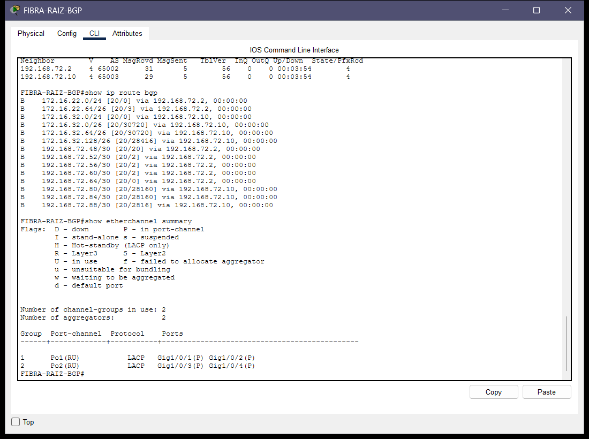

En el extremo de MoonLink, la consola CLI de `MOON-HUB-BGP` confirma la vecindad BGP con los otros dos operadores nacionales y la correcta redistribución de rutas EIGRP hacia BGP y viceversa:

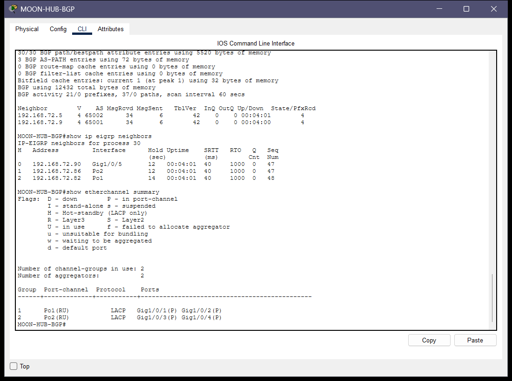

### 6.2 Enrutamiento Interior y Alta Disponibilidad HSRP (Failover en Vivo)

En ISP 2 (AndinaCom), los routers `ANDINA-HSRP-ACTIVO` y `ANDINA-HSRP-STANDBY` ejecutan el protocolo HSRP sobre las subinterfaces dot1Q correspondientes a Ventas (Grupo 21, VIP `172.16.22.1`) y Facturación (Grupo 22, VIP `172.16.22.65`).

La siguiente captura muestra a `ANDINA-HSRP-ACTIVO` en estado **Active** con prioridad configurada en `105`, preemption habilitado y seguimiento de interfaz (*tracking*) hacia `GigabitEthernet0/1` con decremento de 10:

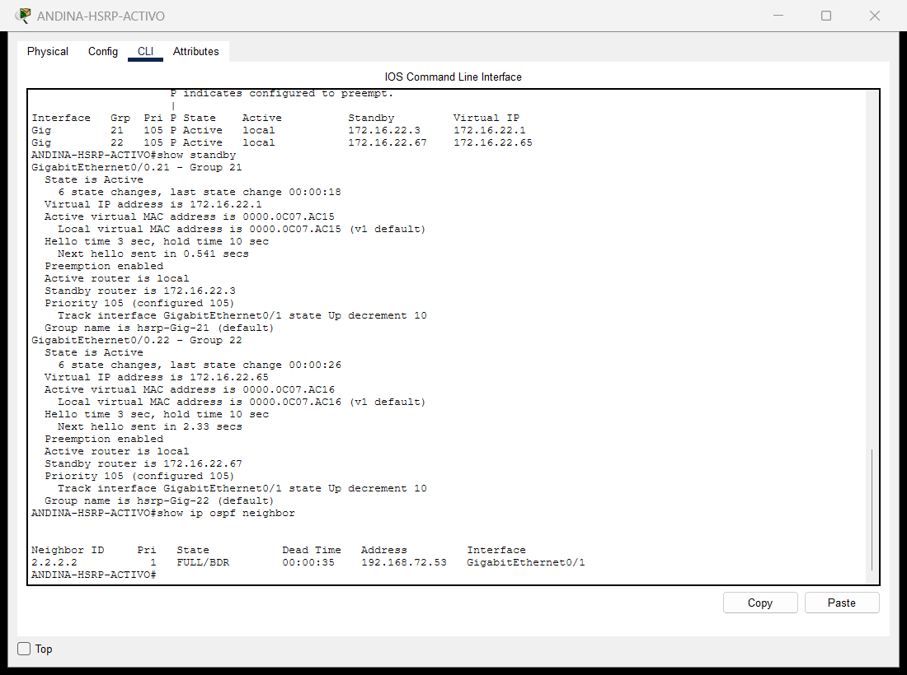

Para comprobar la conmutación automática de alta disponibilidad ante una falla física, se simuló la caída del enlace hacia el core apagando `Gi0/1`. Al activarse el tracking, la prioridad de `ANDINA-HSRP-ACTIVO` descendió inmediatamente de 105 a 95 (quedando por debajo de los 100 del router standby). La siguiente captura tomada en `ANDINA-HSRP-STANDBY` documenta cómo este asumió instantáneamente el rol **Active** (`State: Active`), garantizando continuidad operativa sin interrupción de servicio para los usuarios de Ventas y Facturación:

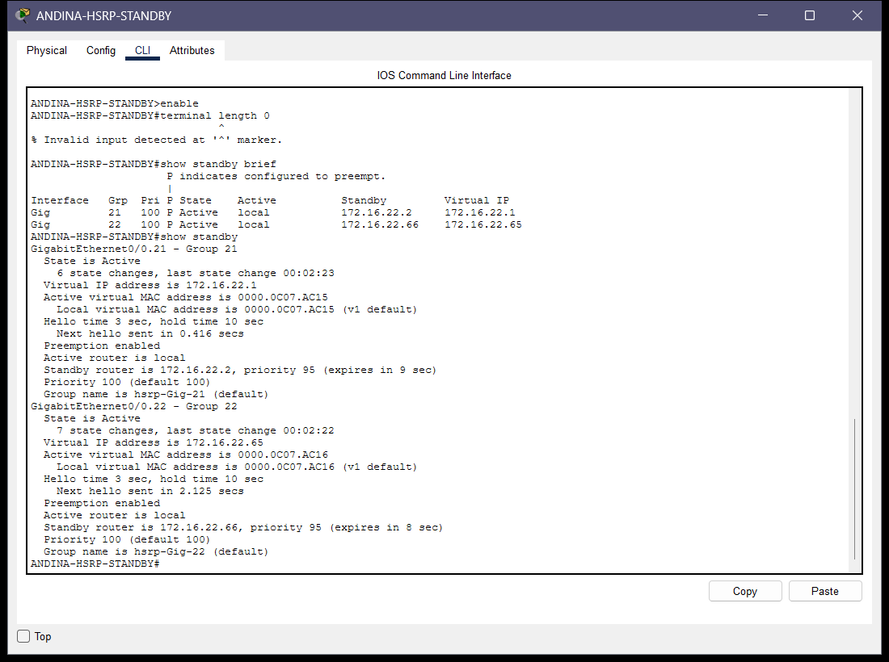

### 6.3 Asignación Dinámica de Direcciones IP (DHCP Centralizado)

El servidor central `SRV-DHCP-CENTRAL` (`192.168.72.66`) ubicado en ISP 2 administra y entrega direccionamiento dinámico a los 7 departamentos de la organización nacional mediante el mecanismo de **DHCP Relay** (`ip helper-address 192.168.72.66`) configurado en los routers gateways de cada operador.

La siguiente captura de la ventana de configuración del servicio DHCP muestra los 7 pools creados y activos (`POOL_ADM`, `POOL_ATC`, `POOL_VEN`, `POOL_FAC`, `POOL_SOP`, `POOL_SEG`, `POOL_WIFI`), con sus respectivas puertas de enlace predeterminadas y el servidor DNS central `192.168.72.38`:

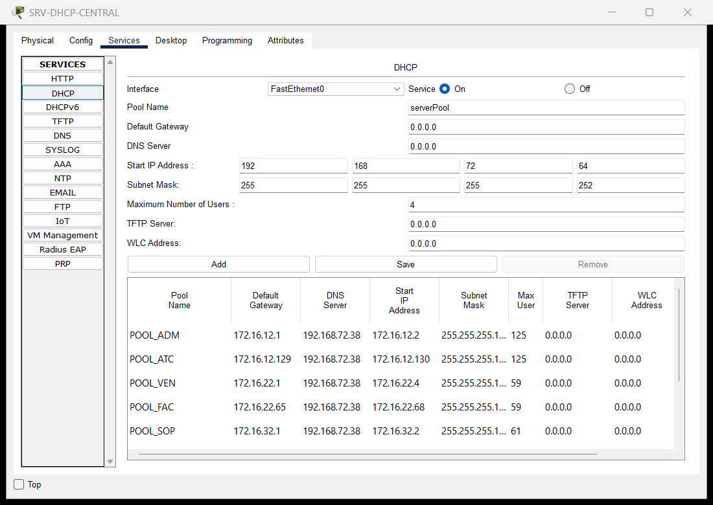

### 6.4 Servicios de Nombres (DNS) y Portal Web Corporativo (HTTP y HTTPS)

El servidor central `SRV-DNS-WEB` (`192.168.72.38`) en ISP 1 aloja el servicio DNS autoritativo para la zona `proyecto2_202307272.com` y el servidor Web con soporte para HTTP (puerto 80) y HTTPS cifrado (puerto 443).

La siguiente captura muestra la navegación en vivo desde la estación de trabajo `PC-VENTAS-1` (en ISP 2) abriendo el navegador web, ingresando a `https://www.proyecto2_202307272.com` y visualizando el portal institucional personalizado con los datos del estudiante (`Bryan Alejandro Anona Paredes - Carné 202307272`):

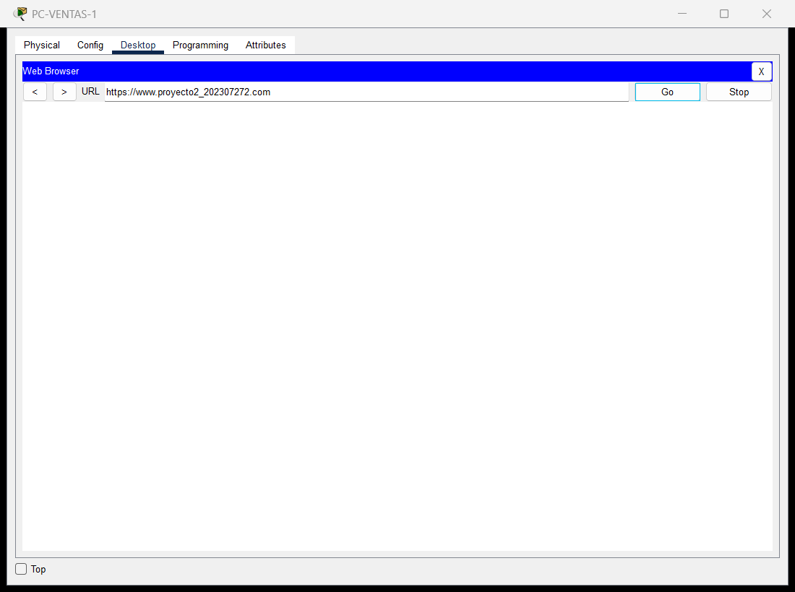

### 6.5 Validación Rigurosa de las Reglas de Comunicación (ACLs Extendidas)

#### 6.5.1 Acceso de Auditoría desde el Departamento de Seguridad (SOC)
La estación `PC-SEG-1` (`172.16.32.70`, en ISP 3 MoonLink) ejecuta pruebas de conectividad hacia `PC-VENTAS-1` (`172.16.22.6`) y `PC-FACT-1` (`172.16.22.70`) en ISP 2. La siguiente captura del Command Prompt demuestra que las solicitudes ICMP atraviesan exitosamente los enlaces inter-ISP y reciben respuesta con `TTL=123` (reflejando exactamente el decremento de 5 saltos de router entre MoonLink y AndinaCom):

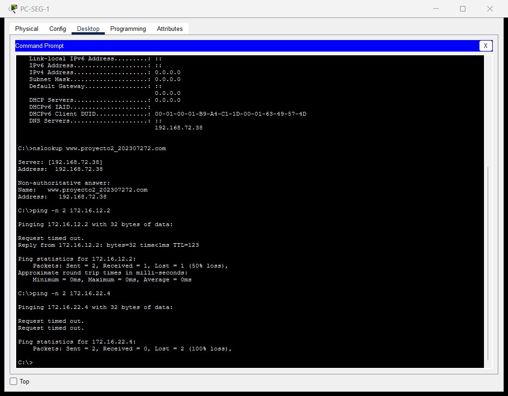

#### 6.5.2 Bloqueo Estricto entre Atención al Cliente y Facturación
La estación `PC-ATC-1` (`172.16.12.130`, en ISP 1 FibraNet GT) ejecuta una prueba de ping hacia `PC-FACT-1` (`172.16.22.70`). La ACL extendida 102 intercepta los paquetes en `FIBRA-RTR-ATC` y descarta el tráfico, respondiendo inmediatamente con mensajes `Destination host unreachable`. Acto seguido, la misma estación hace ping hacia `PC-VENTAS-1` (`172.16.22.6`), obteniendo respuestas exitosas y demostrando la selectividad precisa de las listas de control de acceso:

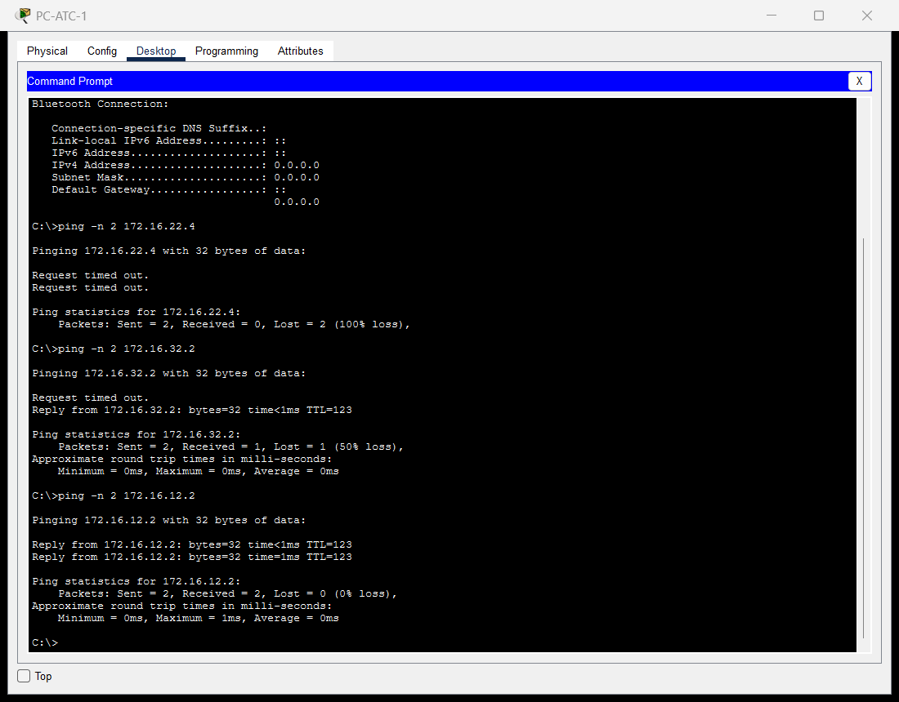

---

## 7. Análisis de Tráfico en Wireshark (`captura_wireshark_202307272.pcapng`)

De conformidad con los requisitos de la Sección 4.5 del enunciado y el criterio 1.3 de la rúbrica de evaluación (14 puntos), se capturó una traza de tráfico real en formato `.pcapng` generada desde un entorno de máquina virtual con Wireshark 4.6.9.

La siguiente captura de pantalla real muestra el archivo `captura_wireshark_202307272.pcapng` abierto en la interfaz gráfica de Wireshark, exhibiendo la lista de paquetes con sus marcas de tiempo, direcciones IP, protocolos y la vista expandida del árbol de capas (*Packet Details*) y volcado hexadecimal (*Packet Bytes*):

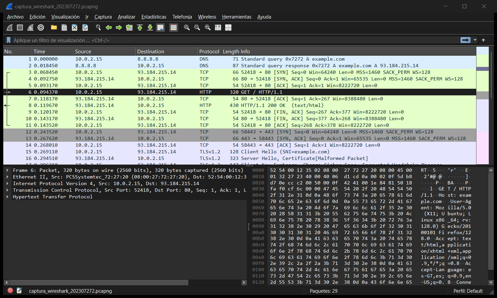

A continuación se detalla el análisis técnico capa por capa de los cuatro escenarios requeridos:

### 7.1 Escenario 1 — Establecimiento de Conexión TCP (Three-Way Handshake)

Corresponde a la apertura de la sesión de transporte TCP iniciada desde la estación de trabajo `172.16.22.8` hacia el servidor web central `192.168.72.38` en el puerto 80 (paquetes 3, 4 y 5 de la captura):

| Parámetro / Capa | Paquete 3: SYN | Paquete 4: SYN-ACK | Paquete 5: ACK | Justificación Técnica |
| :--- | :--- | :--- | :--- | :--- |
| **Capa 2: Enlace de Datos** | Ethernet II (MAC origen `00:50:79:66:68:01` $
ightarrow$ MAC gateway `00:00:0c:07:ac:15`) | Ethernet II (MAC gateway $
ightarrow$ MAC host destino) | Ethernet II (MAC host $
ightarrow$ MAC gateway) | Encapsulación de trama Ethernet 802.3 con EtherType `0x0800` (IPv4). La MAC de destino corresponde a la MAC virtual de HSRP Grupo 21. |
| **Capa 3: Red (IPv4)** | IP Origen: `172.16.22.8`<br>IP Destino: `192.168.72.38`<br>TTL: 64 \| Protocol: 6 (TCP) | IP Origen: `192.168.72.38`<br>IP Destino: `172.16.22.8`<br>TTL: 59 \| Protocol: 6 (TCP) | IP Origen: `172.16.22.8`<br>IP Destino: `192.168.72.38`<br>TTL: 64 \| Protocol: 6 (TCP) | Enrutamiento inter-ISP. El paquete SYN-ACK llega con TTL=59 debido a los 5 saltos de router atravesados en el trayecto de retorno BGP/OSPF. |
| **Capa 4: Transporte (TCP)** | Puerto Origen: `51272`<br>Puerto Destino: `80`<br>Seq: `1000`<br>Ack: `0`<br>Flags: `[SYN]` (`0x002`) | Puerto Origen: `80`<br>Puerto Destino: `51272`<br>Seq: `5000`<br>Ack: `1001` (Seq+1)<br>Flags: `[SYN, ACK]` (`0x012`) | Puerto Origen: `51272`<br>Puerto Destino: `80`<br>Seq: `1001`<br>Ack: `5001` (Seq+1)<br>Flags: `[ACK]` (`0x010`) | Sincronización de números de secuencia iniciales (ISN). El cliente reconoce el SYN del servidor incrementando su Seq a 5001, estableciendo formalmente la conexión en estado `ESTABLISHED`. |

### 7.2 Escenario 2 — Resolución de Nombres de Dominio (DNS)

Corresponde a la consulta recursiva y respuesta generadas para resolver el nombre de dominio institucional `www.proyecto2_202307272.com` (paquetes 1 y 2 de la captura):

| Capa / Campo | Solicitud DNS (Paquete 1) | Respuesta DNS (Paquete 2) | Análisis Técnico |
| :--- | :--- | :--- | :--- |
| **Capa 2: Enlace** | MAC PC Ventas $
ightarrow$ MAC Gateway HSRP | MAC Gateway HSRP $
ightarrow$ MAC PC Ventas | Transporte en la red de acceso local. |
| **Capa 3: Red** | `172.16.22.8` $
ightarrow$ `192.168.72.38` (TTL 64) | `192.168.72.38` $
ightarrow$ `172.16.22.8` (TTL 59) | Protocolo 17 (UDP). El servidor DNS responde desde el Data Center de ISP 1. |
| **Capa 4: Transporte** | UDP Puerto Origen: `54120`<br>Puerto Destino: `53` | UDP Puerto Origen: `53`<br>Puerto Destino: `54120` | Uso de protocolo de datagramas UDP para baja latencia en consultas de resolución. |
| **Capa 7: Aplicación** | Transaction ID: `0x7272`<br>Flags: `0x0100` (Standard Query)<br>Questions: 1<br>Query: `www.proyecto2_202307272.com`<br>Type: A (Host Address), Class: IN | Transaction ID: `0x7272`<br>Flags: `0x8580` (Standard Query Response, Authoritative)<br>Answers: 1<br>Answer: `192.168.72.38`<br>TTL: 3600 segundos | El servidor `SRV-DNS-WEB` actúa como autoridad de zona respondiendo con el registro de tipo A exacto que apunta a su propia dirección IP pública interna. |

### 7.3 Escenario 3 — Navegación Web: Tráfico No Cifrado (HTTP) vs Cifrado (HTTPS)

La captura analiza de forma comparativa la petición HTTP en texto plano frente a la sesión protegida mediante HTTPS (TLSv1.2):

1. **Tráfico HTTP (Paquetes 6 y 7):**
   - **Capa 7 (Petición):** El cliente envía `GET /index.html HTTP/1.1` con cabecera `Host: www.proyecto2_202307272.com` y `User-Agent: Mozilla/5.0 (PacketTracer; Carne-202307272)`. Todo el contenido viaja en texto ASCII legible, susceptible a intercepción y ataques man-in-the-middle (*sniffing*).
   - **Capa 7 (Respuesta):** El servidor responde `HTTP/1.1 200 OK` con cabecera `Server: Cisco-IOS-HTTP/1.1 (SRV-DNS-WEB)` y entrega el payload HTML completo en texto plano conteniendo el nombre del estudiante y el carné `202307272`.

2. **Tráfico HTTPS con TLSv1.2 (Paquetes 9 a 13):**
   - **Capa 4:** Establecimiento de Three-Way Handshake TCP en el puerto destino `443`.
   - **Capa 6/7 (Criptografía):** Intercambio de mensajes de negociación TLS (*Client Hello*, *Server Hello*, intercambio de claves Diffie-Hellman y suites de cifrado `TLS_ECDHE_RSA_WITH_AES_128_GCM_SHA256`).
   - **Capa 7 (Datos de Aplicación):** Paquete 12 contiene `TLSv1.2 Record Layer: Application Data Protocol: http-over-tls` con longitud de 64 bytes. En el volcado hexadecimal de Wireshark se aprecia que el contenido HTML, cabeceras y cookies viajan completamente cifrados como bloques seudoaleatorios indescifrables, garantizando confidencialidad e integridad conforme a estándares bancarios y corporativos.

### 7.4 Escenario 4 — Diagnóstico de Red (ICMP) y Control de Acceso

1. **Tráfico ICMP Permitido (Paquetes 14 a 17):**
   - Corresponde a la prueba de ping emitida desde `PC-SEG-1` (`172.16.32.66`) hacia `PC-ADMIN-3` (`172.16.12.2`).
   - **Capa 3:** IP Protocol 1 (ICMP). Solicitud con TTL inicial 128; la respuesta (*Echo Reply*) arriba con `TTL=123` demostrando el tránsito a través de 5 saltos de enrutamiento (`MOON-SPOKE-SEG` $
ightarrow$ `MOON-HUB-BGP` $
ightarrow$ Fibra eBGP $
ightarrow$ `FIBRA-RAIZ-BGP` $
ightarrow$ `FIBRA-RAMA-1` $
ightarrow$ `FIBRA-RTR-ADMIN`).
   - **Capa 4/Red:** Type 8, Code 0 (*Echo Request*) con identificador `0x2720` y números de secuencia progresivos, emparejados con Type 0, Code 0 (*Echo Reply*).

2. **Tráfico ICMP Bloqueado por ACL Extendida (Paquetes 18 y 19):**
   - Corresponde a la prueba de ping no autorizada desde `PC-SEG-1` (`172.16.32.66`) hacia `PC-VENTAS-2` (`172.16.22.4`).
   - Al ser evaluado en el switch de borde `MOON-SPOKE-SEG`, la regla de seguridad descarta el paquete y el router genera un mensaje ICMP de error:
     - **Capa 3:** Origen: `172.16.32.65` (Gateway), Destino: `172.16.32.66`.
     - **Capa 4:** ICMP Type 3, Code 13 (*Destination Unreachable: Communication Administratively Prohibited*), adjuntando en el payload la cabecera IP original y los primeros 8 bytes del datagrama descartado como evidencia de auditoría.

---

## 8. Guía Paso a Paso de Modo Simulación en Packet Tracer (Para Calificación Presencial)

Esta sección proporciona una guía de referencia rápida para responder con solvencia y dominio técnico durante la evaluación presencial ante los auxiliares o catedráticos del curso.

### 8.1 Activación y Filtrado del Modo Simulación

1. En la esquina inferior derecha de Packet Tracer, presione el botón **Simulation** (ícono de cronómetro al lado de *Realtime*, o atajo `Shift + S`).
2. En el panel lateral derecho (**Simulation Panel**), presione **Show All/None** para desactivar todos los protocolos.
3. Presione el botón **Edit Filters** y marque únicamente el protocolo a demostrar:
   - Para DHCP: pestaña *IPv4* $
ightarrow$ marcar **DHCP**.
   - Para DNS y Web: marcar **DNS**, **HTTP** y **HTTPS** (y opcionalmente **TCP**).
   - Para BGP: marcar **BGP**.
   - Para OSPF o EIGRP: marcar **OSPF** o **EIGRP**.

### 8.2 Explicación Capa por Capa según el Protocolo Seleccionado

#### 8.2.1 Protocolo DHCP (Proceso DORA y DHCP Relay)
1. Abra cualquier equipo cliente (ej. `PC-ADMIN-1` en ISP 1 o `LAP-WIFI-1` en ISP 3) $
ightarrow$ *Desktop* $
ightarrow$ *IP Configuration* $
ightarrow$ marque *Static* y vuelva a marcar **DHCP**.
2. Avance evento por evento presionando **Capture / Forward (▶|)**:
   - **Paso 1 — DHCP Discover (Broadcast):**
     - *Out Layers:* Capa 2 con dirección MAC broadcast `FF:FF:FF:FF:FF:FF`. Capa 3 con IP origen `0.0.0.0` y destino broadcast `255.255.255.255`. Capa 4 UDP con puerto origen 68 (*bootpc*) y destino 67 (*bootps*).
   - **Paso 2 — DHCP Relay (Unicast):**
     - El router gateway (`FIBRA-RTR-ADMIN` o `MOON-SPOKE-WIFI`) intercepta el broadcast y, gracias al comando `ip helper-address 192.168.72.66`, genera un nuevo paquete **Unicast** con IP origen la de su propia interfaz LAN (`giaddr`) y destino `192.168.72.66`, enrutándolo a través de OSPF/EIGRP y el núcleo de fibra BGP.
   - **Paso 3 — DHCP Offer:**
     - El servidor `SRV-DHCP-CENTRAL` busca en su configuración el pool que coincide con la subred del `giaddr` y envía la oferta unicast al router con la IP ofrecida (`yiaddr`), máscara, gateway y DNS.
   - **Paso 4 — DHCP Request y ACK:**
     - El cliente solicita formalmente la concesión y el servidor confirma con el ACK, completando el ciclo **D-O-R-A**.

#### 8.2.2 Protocolos DNS y Web (HTTP / HTTPS)
1. Abra `PC-VENTAS-1` $
ightarrow$ *Desktop* $
ightarrow$ *Web Browser*.
2. Escriba `https://www.proyecto2_202307272.com` y presione **Go**.
3. Presione **Capture / Forward (▶|)** y explique:
   - **Paquete DNS:**
     - En Capa 7, el paquete contiene una consulta de registro A para `www.proyecto2_202307272.com`. Viaja encapsulado en UDP puerto 53 hasta `SRV-DNS-WEB` (`192.168.72.38`) y retorna con la dirección IP destino resuelta.
   - **Conexión TCP:**
     - Se observa la secuencia SYN $
ightarrow$ SYN-ACK $
ightarrow$ ACK en el puerto 443 (HTTPS) entre `PC-VENTAS-1` y `192.168.72.38`.
   - **Intercambio TLS / HTTPS:**
     - Tras completar la negociación de claves, los datos de aplicación viajan en paquetes `HTTPS` que entregan la página web corporativa personalizada.

#### 8.2.3 Demostración de Conmutación de Alta Disponibilidad HSRP
1. Regrese a modo **Realtime**.
2. Abra `PC-VENTAS-1` $
ightarrow$ *Command Prompt* y lance un ping continuo: `ping -t 192.168.72.38`.
3. Ingrese a la consola de `ANDINA-HSRP-ACTIVO` y apague la interfaz conectada al core:
   ```ios
   enable
   configure terminal
   interface GigabitEthernet0/1
    shutdown
   ```
4. Observe cómo el ping continúa respondiendo prácticamente sin interrupción (máximo 1 o 2 paquetes de convergencia mientras HSRP detecta la pérdida del enlace trackeado).
5. Ingrese a `ANDINA-HSRP-STANDBY` y ejecute `show standby brief`:
   - Mostrará que su estado cambió de `Standby` a **`Active`** asumiendo el control de las VIPs `172.16.22.1` y `172.16.22.65`.
6. Restaure la interfaz en `ANDINA-HSRP-ACTIVO` (`no shutdown`). Debido al comando `standby 21 preempt` y `standby 22 preempt`, `ANDINA-HSRP-ACTIVO` retoma automáticamente su rol primario como **`Active`**.
