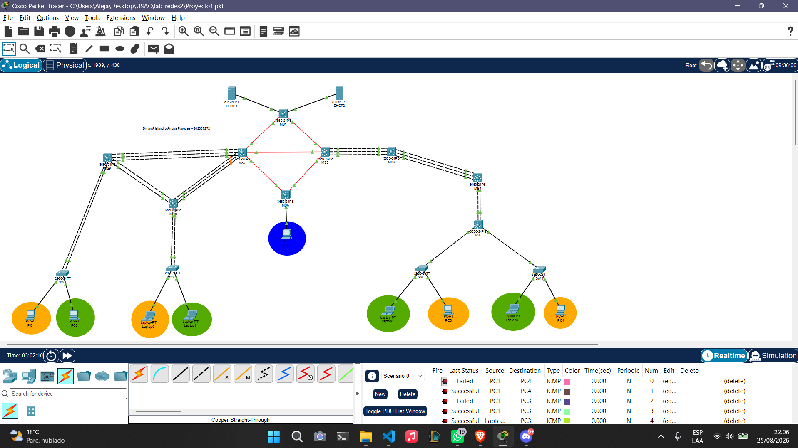
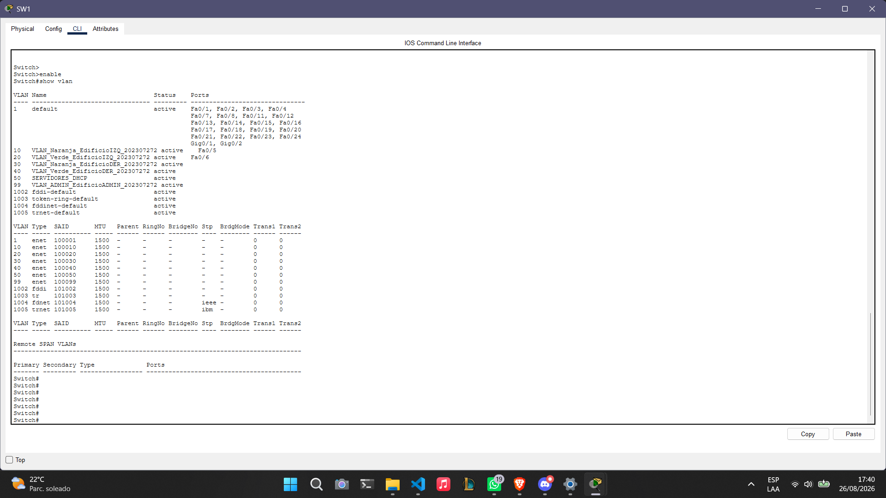
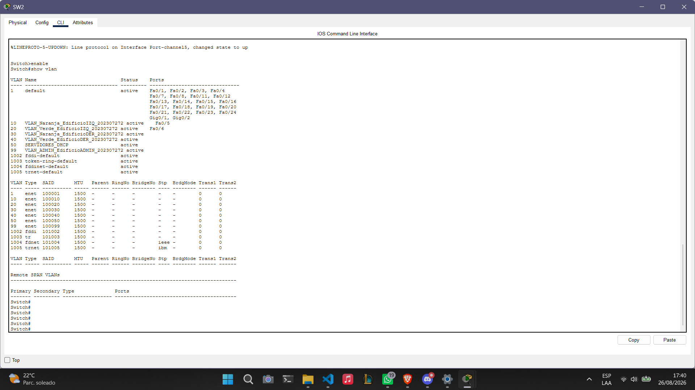
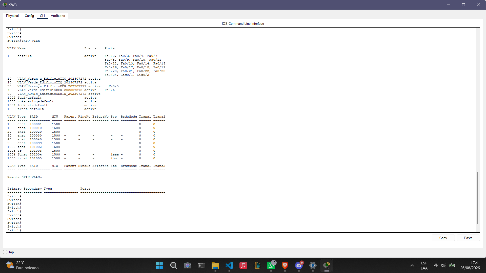
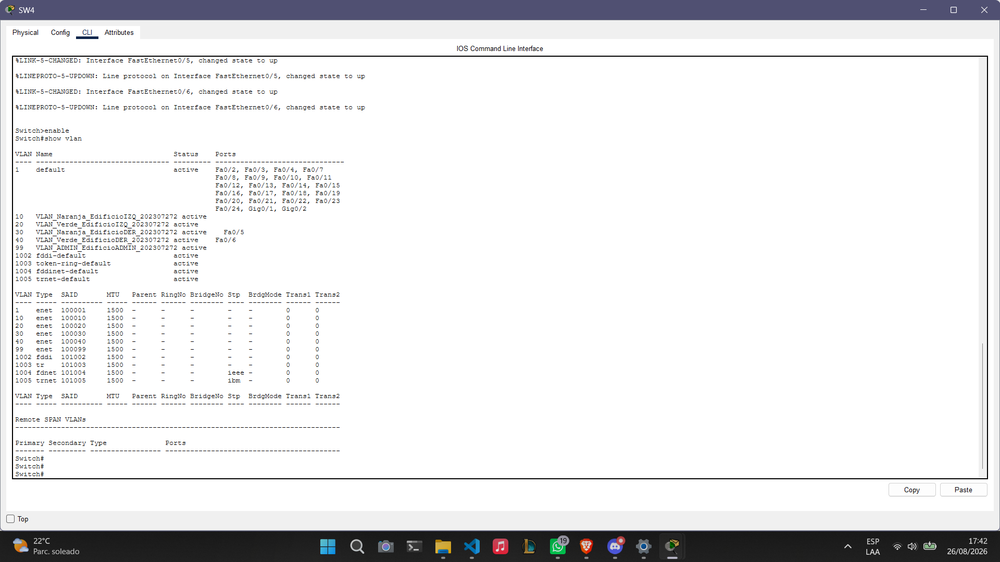
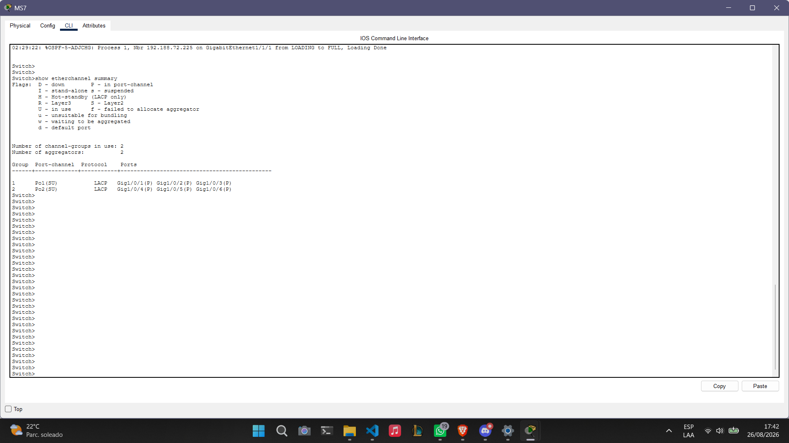
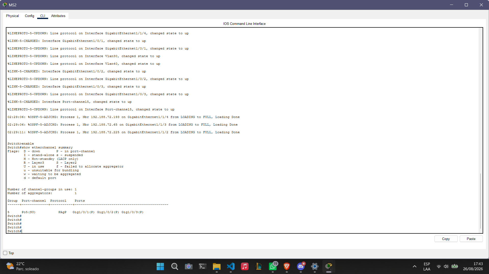
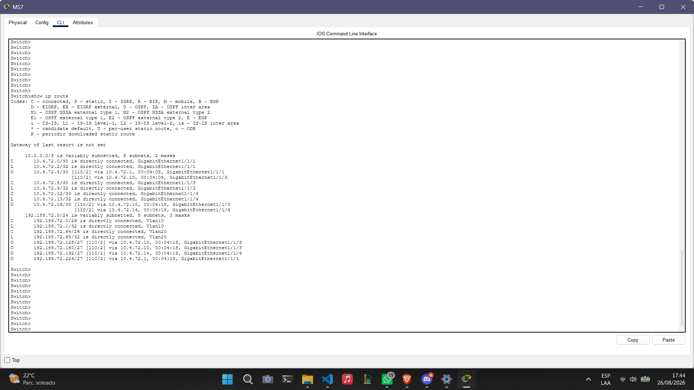
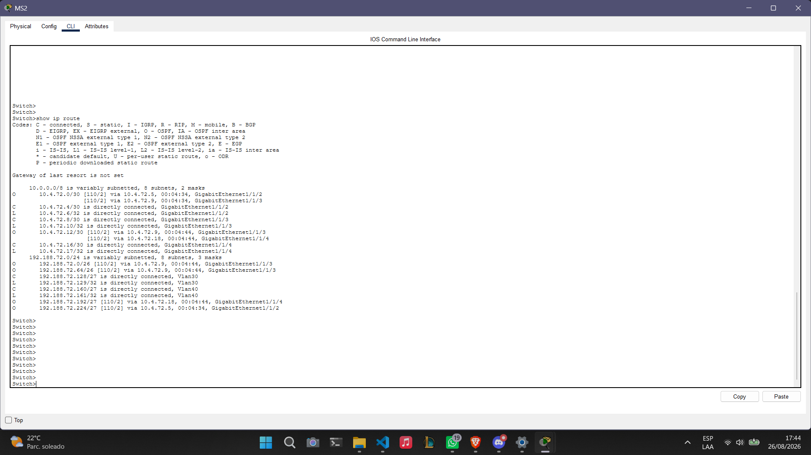

# Proyecto 1 - Chapin Red
**Universidad de San Carlos de Guatemala**  
**Facultad de Ingeniería - Escuela de Ciencias y Sistemas**  
**Laboratorio de Redes de Computadoras 2**  
**Estudiante:** Bryan Alejandro Anona Paredes  
**Carné:** 202307272  

---

## 1. Topología de la Red


---

## 2. Esquema de Direccionamiento IP (Subnetting)
Se utilizó la red base `192.188.72.0/24` para el direccionamiento de hosts mediante VLSM, y la red `10.4.72.0/24` para los enlaces punto a punto mediante FLSM.

### VLSM (VLANs de Usuarios y Administración)
| VLAN | Nombre | Dirección de Red | Máscara | Gateway (IP Utilizable) | Rango DHCP |
| :--- | :--- | :--- | :--- | :--- | :--- |
| **10** | VLAN_Naranja_EdificioIZQ_202307272 | 192.188.72.0/26 | 255.255.255.192 | 192.188.72.1 | .10 - .59 |
| **20** | VLAN_Verde_EdificioIZQ_202307272 | 192.188.72.64/26 | 255.255.255.192 | 192.188.72.65 | .75 - .124 |
| **30** | VLAN_Naranja_EdificioDER_202307272 | 192.188.72.128/27 | 255.255.255.224 | 192.188.72.129 | .135 - .159 |
| **40** | VLAN_Verde_EdificioDER_202307272 | 192.188.72.160/27 | 255.255.255.224 | 192.188.72.161 | .170 - .194 |
| **99** | VLAN_ADMIN_EdificioADMIN_202307272 | 192.188.72.192/27 | 255.255.255.224 | 192.188.72.193 | .200 - .219 |
| **50** | SERVIDORES_DHCP | 192.188.72.224/27 | 255.255.255.224 | 192.188.72.225 | Estáticas (.226, .227)|

### FLSM (Enlaces de Enrutamiento MAN)
Todas las subredes utilizan máscara `/30` (255.255.255.252).
*   **Enlace MS1 - MS7:** 10.4.72.0/30 (IPs .1 y .2)
*   **Enlace MS1 - MS2:** 10.4.72.4/30 (IPs .5 y .6)
*   **Enlace MS7 - MS2:** 10.4.72.8/30 (IPs .9 y .10)
*   **Enlace MS7 - MS6:** 10.4.72.12/30 (IPs .13 y .14)
*   **Enlace MS2 - MS6:** 10.4.72.16/30 (IPs .17 y .18)

---

## 3. Comandos Principales Utilizados

### VTP y VLANs
Se configuró el dominio `ChapinRed` y contraseña `redes2`.
```text
vtp mode server 
vtp domain ChapinRed
vtp password redes2
vlan 10
name VLAN_Naranja_EdificioIZQ_202307272
```






### Agregación de Enlaces (LACP y PAgP)

```text
! Ejemplo LACP (Edificio Izquierdo)
interface range GigabitEthernet 1/0/1 - 3
 channel-group 1 mode active

! Ejemplo PAgP (Edificio Derecho)
interface range GigabitEthernet 1/0/1 - 3
 channel-group 5 mode desirable
 ```




### Enrutamiento Dinámico (OSPF)

```text
router ospf 1
 network 10.4.72.0 0.0.0.255 area 0
 network 192.188.72.0 0.0.0.255 area 0
```




### Configuración DHCP Relay

```text
interface vlan 10
 ip helper-address 192.188.72.226
```

### Listas de Control de Acceso (ACLs)

Propósito: La ACL aplicada en VLAN 10 permite tráfico a la misma red, bloquea hacia VLAN 20 y VLAN 99, y permite el resto de tráfico. El control unidireccional para ADMIN se logró con la cláusula `established`.

```text
ip access-list extended ACL_NARANJA_IZQ
 permit ip 192.188.72.0 0.0.0.63 192.188.72.0 0.0.0.63
 deny ip 192.188.72.0 0.0.0.63 192.188.72.64 0.0.0.63
 deny ip 192.188.72.0 0.0.0.63 192.188.72.192 0.0.0.31
 permit ip any any

ip access-list extended ACL_BLOQUEO_ENTRADA
 permit tcp any any established
 permit udp any any
 deny ip any 192.188.72.192 0.0.0.31
 permit ip any any
```